# Tutorial 1 - Creating Apps

!!! learn "In this tutorial we will learn"
    - the parts of Qt Designer's interface that we use in these tutorials
    - how to design a simple window with a formatted label
    - how to convert a ***.ui*** file into a Python view file with `pyuic6`
    - how to run and test our app

!!! terms "Terminology"
    - **widget** – any part of a Qt user interface, such as a window, label, button or layout.
    - **property** – a setting that belongs to a widget, such as its size, text or font.
    - **camel case** – writing names with no spaces, starting each new word with a capital letter, like `windowTitle`.

In this tutorial we'll make a very simple app, because the point is to learn the workflow. In every tutorial we will design a UI in Qt Designer, convert it to a Python file, and run it with the boilerplate code we downloaded in [Setup](../start/setup.md#pyqt-boilerplate-code). The process is the same however complicated the app gets.

## Meet Qt Designer

It's easy to underestimate how complicated user interfaces are. Just knowing which components are available is a challenge, let alone arranging them and making them resize nicely. Seeing what our UI will look like while we build it makes life much easier, and that's what Qt Designer does. So let's open Qt Designer.

### New Form dialog

When Qt Designer opens, it shows the **New Form** dialog. We use it to create new windows, open earlier UI files and get to recent designs.

1. Make sure **Main Window** is selected, then click **Create**.
    - Result: a new, empty main window opens in Qt Designer.

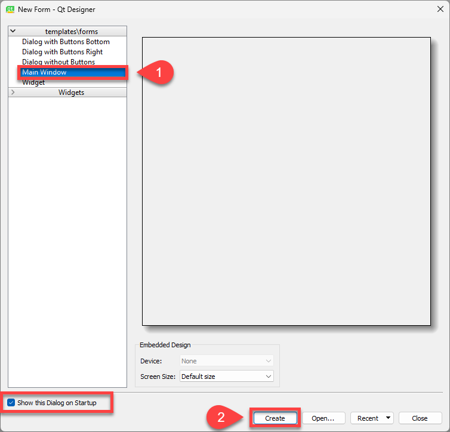

### Qt Designer's interface

These tutorials use four parts of Qt Designer's interface:

1. **Widget Box**: all of Qt's UI components, grouped into sections such as **Layouts**, **Buttons** and **Display Widgets**.
2. **Window canvas**: the window we're designing.
3. **Object Inspector**: every component in the window, showing which components sit inside others.
4. **Property Editor**: the properties of the selected component, which we can change.

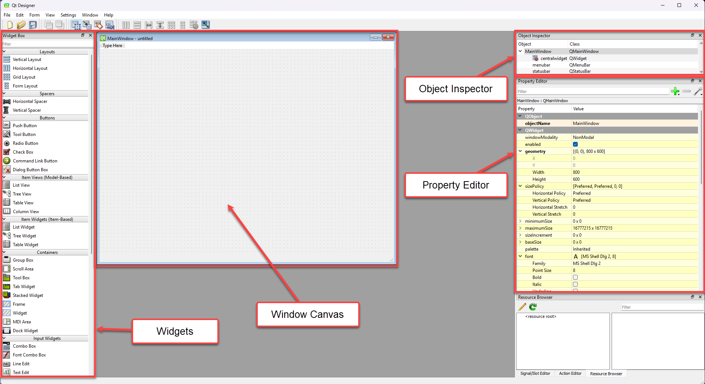

We won't use the **Resource Browser**, **Action Editor** or **Signal/Slot Editor** in the bottom-right corner, so we can close them to get more space.

!!! tip "A word on widgets"
    Qt calls everything a **widget**. Windows are widgets, text boxes are widgets, and even layouts are widgets. These tutorials use more specific names, such as label or button, but remember "widget" when searching for help.

---

## Hello World!

Time to make our first app, a classic **Hello World!**

### Adjust the window

Our window doesn't need a menu, so first we'll remove the menu bar placeholder at the top of the window.

1. Right-click where it says **Type Here** and choose **Remove Menu Bar**.

    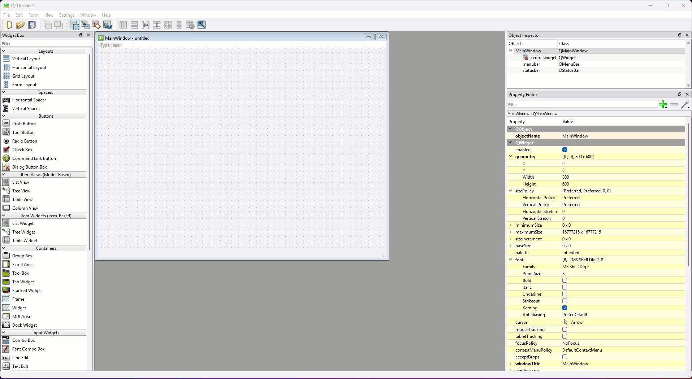

2. In the **Property Editor**, set **geometry** → **Width** to `400` and **Height** to `300`.
    - Result: the window canvas changes size.

    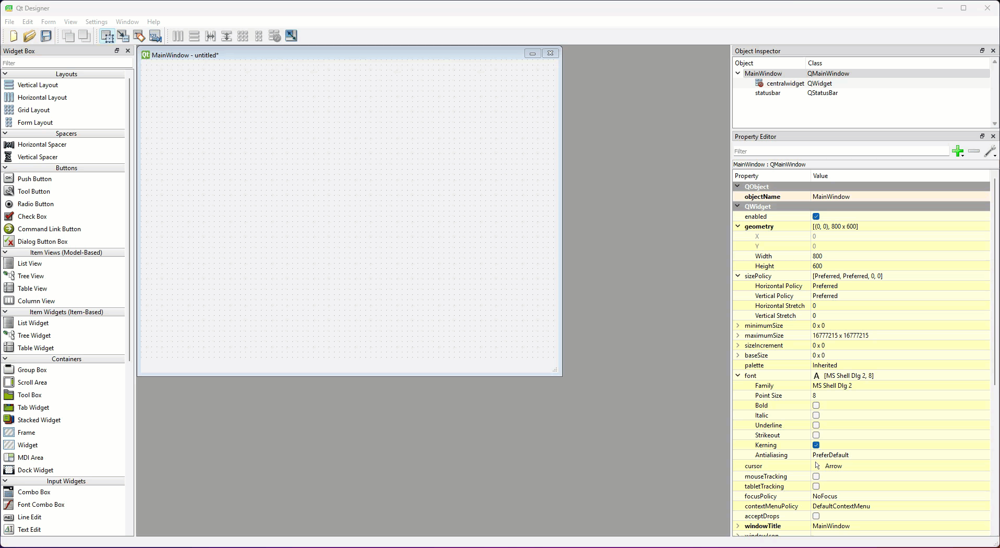

    !!! tip "Expanding the Property Editor"
        If the Property Editor looks different to the examples, a section may be collapsed. For example, if we can't see **Width** and **Height**, click the **>** beside **geometry** to expand it.

3. Scroll down the **Property Editor** to **windowTitle** and change it from **MainWindow** to **Tutorial 1**.

    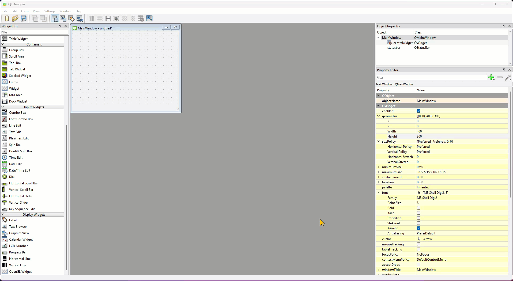

!!! tip "Naming conventions"
    Qt is written in C++, which uses the **camel case** naming convention (`windowTitle`) instead of Python's snake case (`window_title`). Every Qt property, method and signal uses camel case, so our PyQt code will mix both styles: snake case for the names we make up, and camel case for the names that come from Qt.

### Add a label

1. In the **Widget Box**, scroll down to **Display Widgets** and drag a **Label** onto the window canvas.

    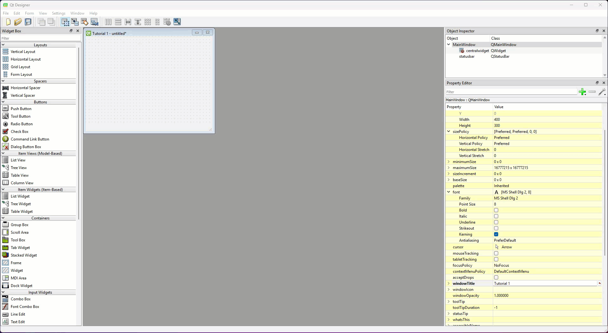

2. Double-click the label, type **Hello World!**, then click the window canvas away from the label.
    - Result: the label shows **Hello World!**

    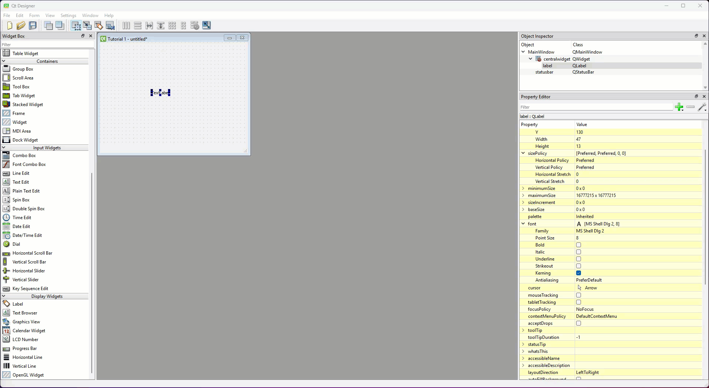

That text is too small to read easily.

3. In the **Property Editor**, expand **font** and set **Point Size** to `20`, then drag the label's blue handles so the whole message shows.

    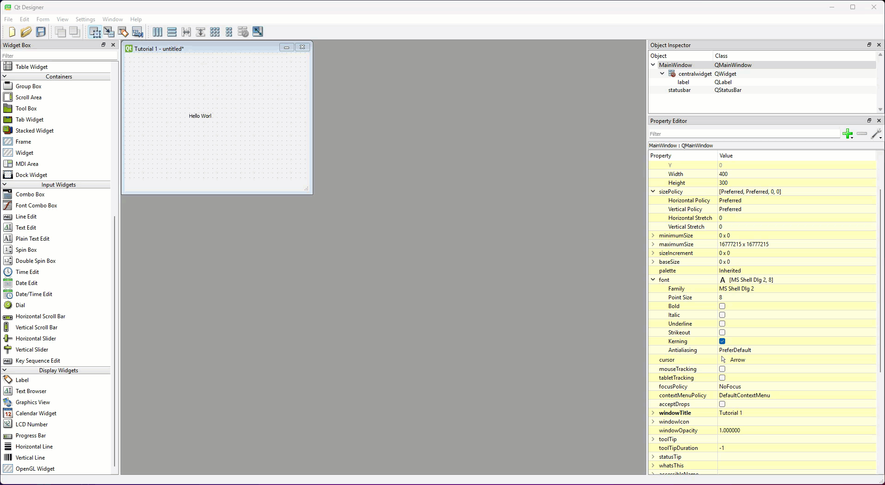

### Save the UI file

Our Python code looks for the UI in the same folder, so the UI file must be saved in our repo, next to ***main_window.py***.

1. Choose **File** → **Save**, go to the **PyQt6-Boiler-Plate** folder and save the file as ***tutorial_01.ui***.
    - Result: ***tutorial_01.ui*** appears in VS Code's file panel.

---

## Convert the UI file

Python can't use a ***.ui*** file as it is, so we'll convert it into a Python file. This becomes the **view** part of our app.

1. Open VS Code from GitHub Desktop (**Open in Visual Studio Code**) if it isn't already open, and check ***tutorial_01.ui*** is in the file panel.

    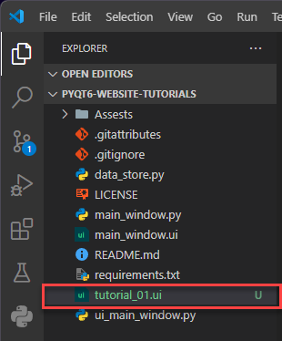

2. Open a new terminal (**Terminal** → **New Terminal**) and check the prompt starts with `(.venv)`.
3. Type the command below and press ++enter++.

    ```text
    pyuic6 -o ui_main_window.py -x tutorial_01.ui
    ```

    - Result: ***ui_main_window.py*** is replaced with a new version built from our design.

    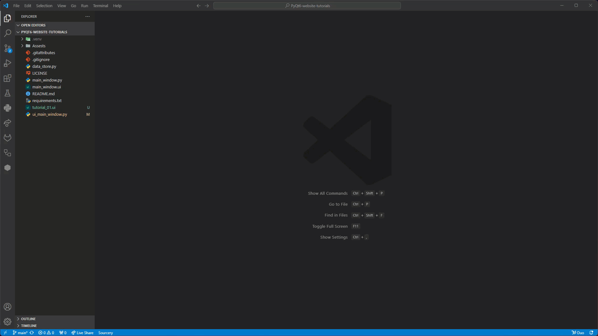

!!! tip "The convert command"
    - `pyuic6` → the **Py**thon **UI** **c**onverter for PyQt**6**, which was installed with PyQt6
    - `-o ui_main_window.py` → the **o**utput file to create
    - `-x tutorial_01.ui` → the UI file to convert (`-x` also adds code so the view file can run by itself)

!!! warning "Don't edit the view file"
    ***ui_main_window.py*** is rebuilt every time we convert a UI file, so any changes we make to it will be lost. All our own code goes in the controller file instead.

## Run the app

1. Open ***main_window.py*** and click the **Run** button (the triangle in the top-right corner of VS Code).
    - Result: a window titled **Tutorial 1** opens, showing **Hello World!**

    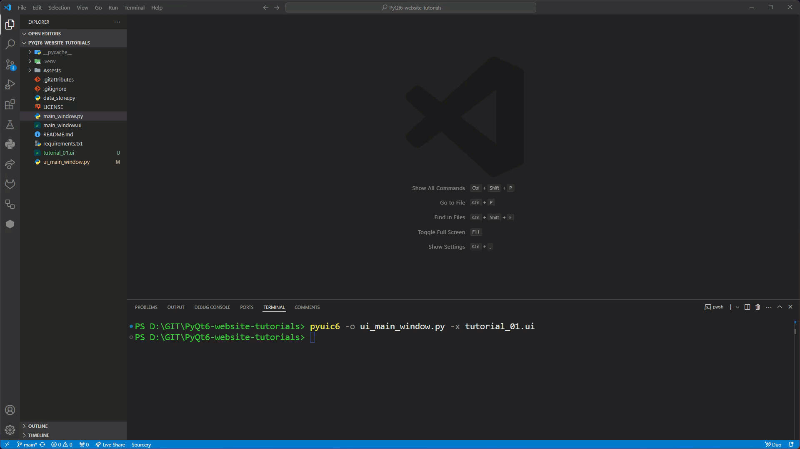

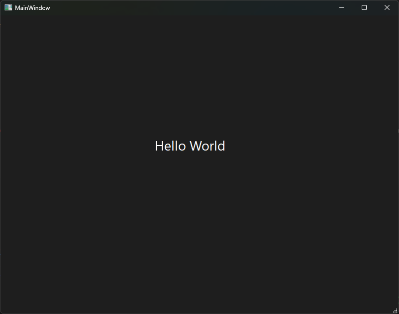

## Testing

Check that:

1. the window title is **Tutorial 1**
2. the window is 400 × 300 pixels when it opens
3. **Hello World!** is large enough to read

Congratulations, we've made our first PyQt app. It may be simple, but we've learnt the workflow we'll use over and over again. In the next tutorial we'll learn more about the label widget.

## Exercises

### Exercise 1

Can you make a second app that shows your name and your favourite subject in two labels, with the window title set to your name? Save the UI file as ***exercise_01.ui***, convert it, and run it from ***main_window.py***.
