# Tutorial 2 - Labels

!!! learn "In this tutorial we will learn"
    - how to change a label's geometry, alignment and margin
    - how to copy widgets in a window
    - how to style a label with a style sheet (text colour, background colour and border)
    - how to show an image in a label

!!! terms "Terminology"
    - **geometry** – a widget's position and size, given as x, y, width and height in pixels.
    - **style sheet** – a set of CSS-style rules that changes how a widget looks, such as its colours, font and border.
    - **pixmap** – an image that Qt can display, such as a PNG file shown in a label.

The **label** is Qt's most common display widget, and most of our UIs will be made of labels. In this tutorial we'll learn how to change some of a label's basic properties.

!!! tip "Qt documentation"
    The official [QLabel documentation](https://doc.qt.io/qt-6/qlabel.html) lists every property and method a label has.

## Create a new window

Using what we learnt in [Tutorial 1](01_creating_apps.md):

1. Create a new **Main Window**.
2. Remove the **menu bar**.
3. Change **windowTitle** to **Tutorial 2**.

## First label

1. Drag a **Label** from the **Widget Box** to the centre of the window canvas, double-click it and change its text to **Hello World**.

    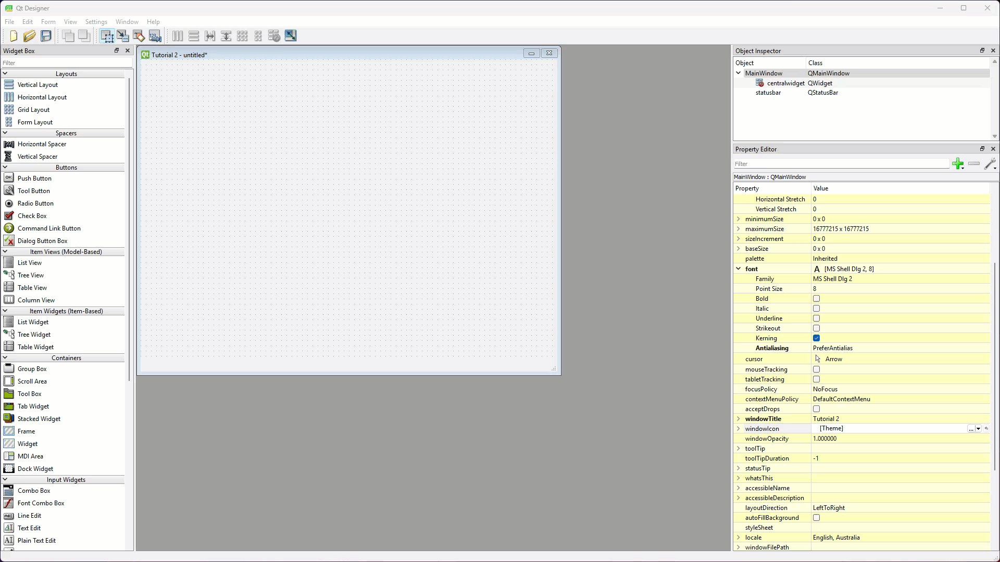

2. In the **Property Editor**, set the label's **geometry** → **Width** to `260` and **Height** to `120`, and its **font** → **Point Size** to `20`.

    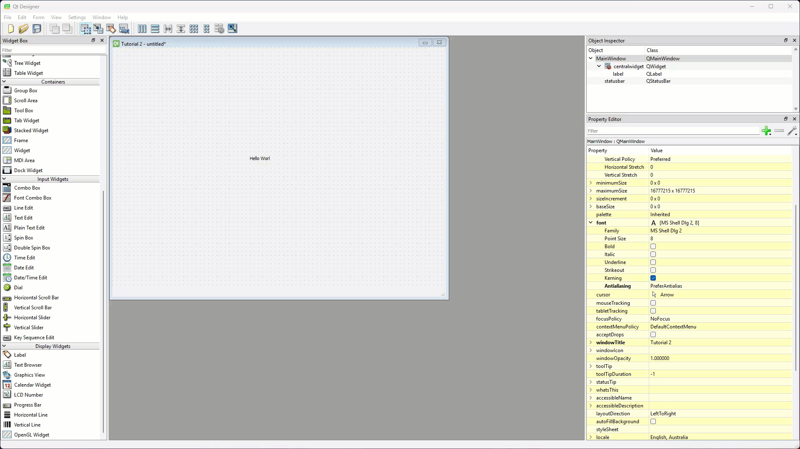

Next we'll change where the text sits inside the label.

3. Scroll down to the **QLabel** section and expand **alignment**. Set **Vertical** to **AlignTop**, then set **margin** to `20`.
    - Result: the text moves to the top of the label, 20 pixels in from the edge.

    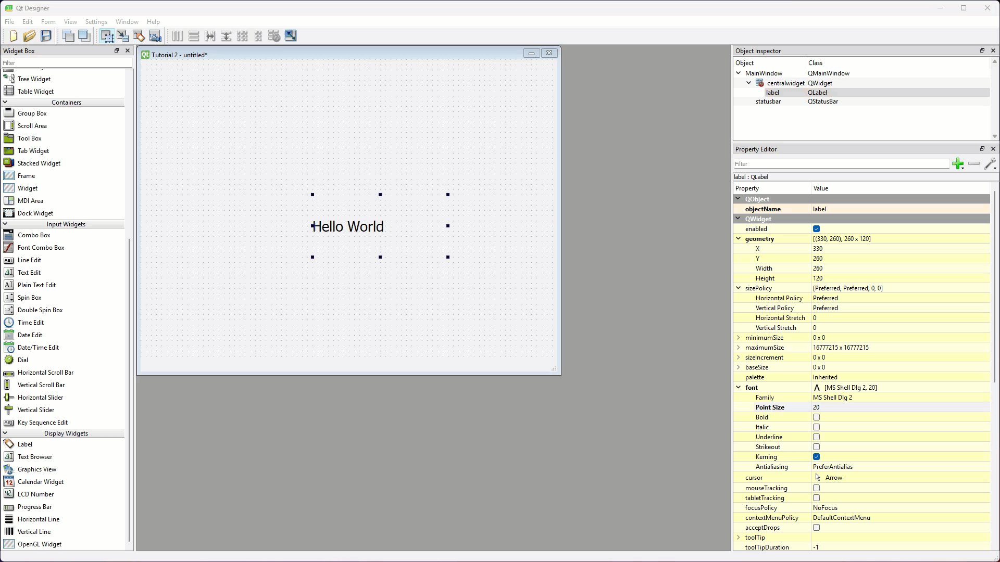

Finally we'll style the label with its **style sheet**.

4. Scroll back up to the **QWidget** section, find **styleSheet** and click the **...** button on its right.
5. Type the rules below, check the dialog says **Valid Style Sheet**, then click **OK**.

    ```text
    background-color: red;
    color: yellow;
    border: 2px solid black;
    ```

    - Result: the label has a red background, yellow text and a black border.

    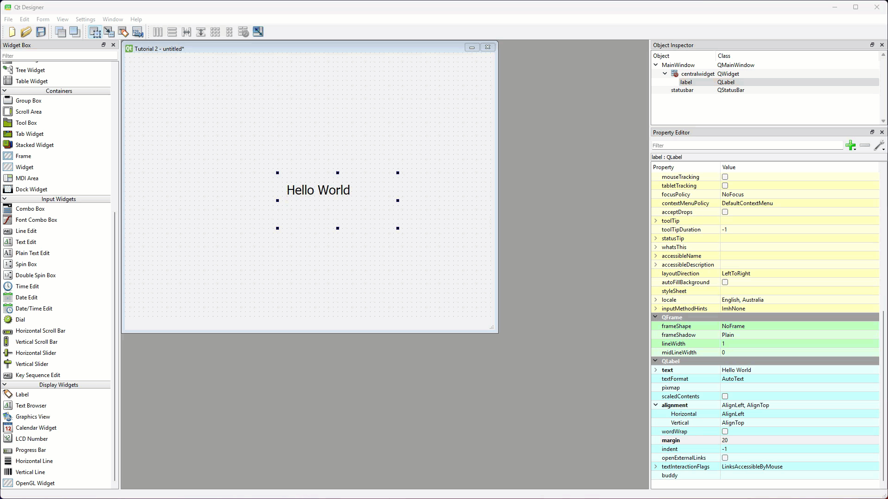

!!! tip "Style sheets"
    Qt style sheets use rules like the CSS used on websites. They can change the look of one widget or the whole app. We'll use them again later, and the [Qt Style Sheets documentation](https://doc.qt.io/qt-6/stylesheet.html) shows everything they can do.

## Second label

To make the second label, we'll copy the first one.

1. Hold ++ctrl++ (++cmd++ on macOS) and drag the first label to make a copy, then change the copy's text to **It is me**.

    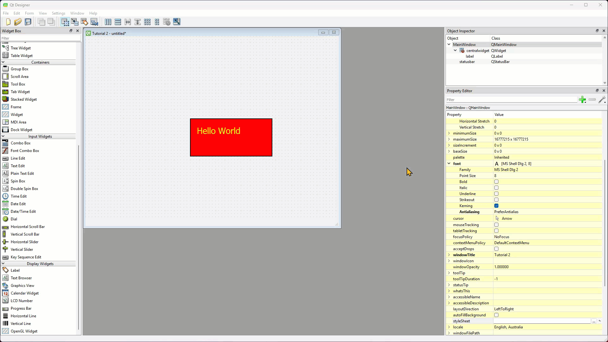

2. Expand **alignment** and set **Horizontal** to **AlignHCenter** and **Vertical** to **AlignVCenter**.
    - Result: the text sits in the middle of the label.

    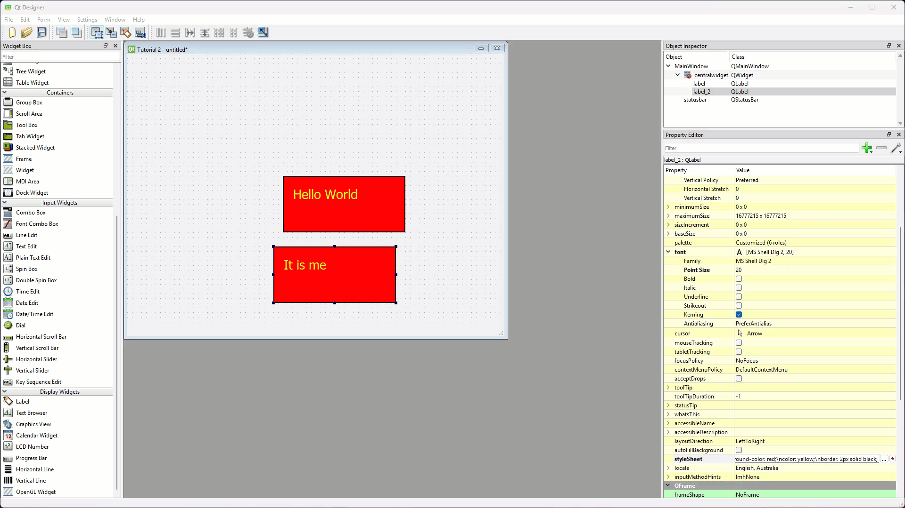

3. Open the second label's style sheet, delete the `color` and `border` rules, change the background to `cyan`, check it's valid and click **OK**.

    ```text
    background-color: cyan;
    ```

    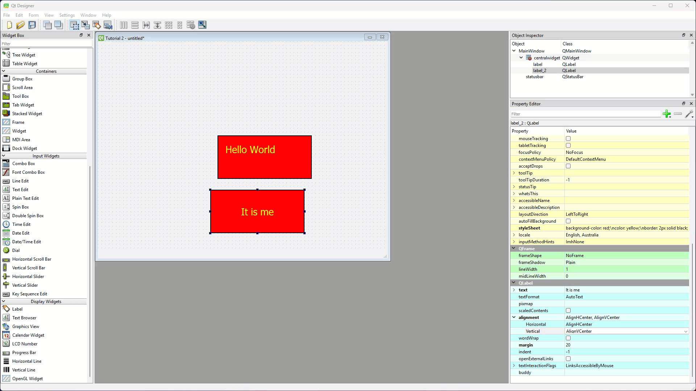

## Third label

Labels can show images as well as text. For the third label we need the image below. Right-click it, choose **Save image as** and save it in our **PyQt6-Boiler-Plate** folder (or [download mr-coder.png](../downloads/mr-coder.png)).

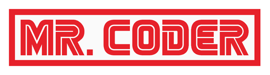

1. Drag a new **Label** onto the window canvas, above the other two labels.

    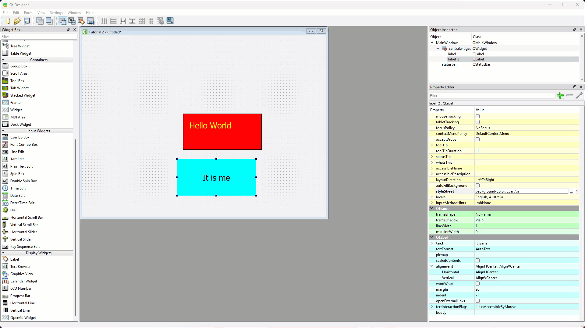

2. In the **QLabel** section, click the empty space beside **pixmap**, click the drop-down arrow and choose **Choose File...**, then select ***mr-coder.png***. Tick **scaledContents**.
    - Why: a **pixmap** is an image Qt can display, and **scaledContents** stretches it to fill the label.
    - Result: the image appears in the label (our folder location will be different to the one in the GIF).

    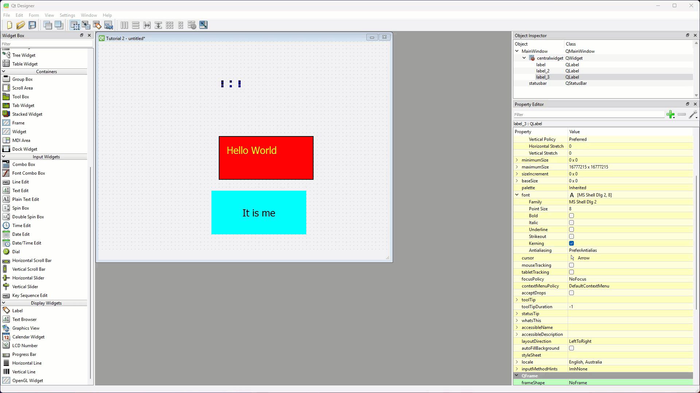

3. In the **QWidget** section, set this label's **geometry** → **Width** to `250` and **Height** to `70`.

    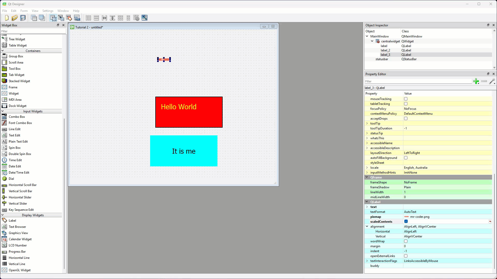

## Save, convert and run

These are the same steps as [Tutorial 1](01_creating_apps.md#save-the-ui-file), with a new file name.

1. Save the UI in our **PyQt6-Boiler-Plate** folder as ***tutorial_02.ui***.
2. In the VS Code terminal, convert it:

    ```text
    pyuic6 -o ui_main_window.py -x tutorial_02.ui
    ```

3. Run ***main_window.py***.
    - Result: a window similar to the one below opens.

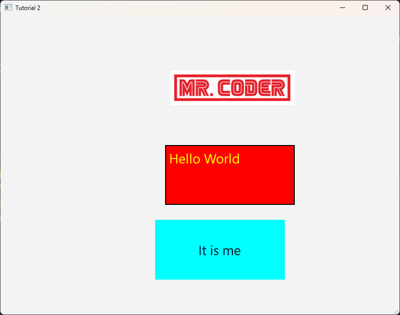

## Testing

Check that:

1. the window title is **Tutorial 2**
2. the first label has a red background, yellow text at the top and a black border
3. the second label's text is in the middle of a cyan background
4. the image fills the third label

We've changed some of the label's basic properties. There are many more, but these are enough for most UIs.

## Exercises

### Exercise 1

Can you design a "student ID card" window with a photo label, a name label and a year level label, each with its own style sheet? Try `border-radius`, `font-weight: bold;` and `padding` in your style sheets, and check the [Qt Style Sheets reference](https://doc.qt.io/qt-6/stylesheet-reference.html) for more ideas.
