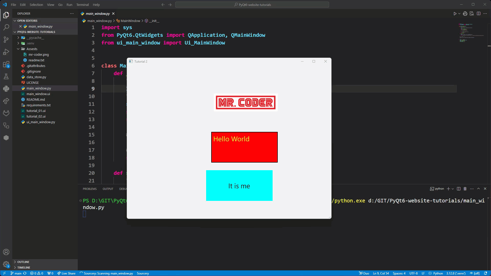
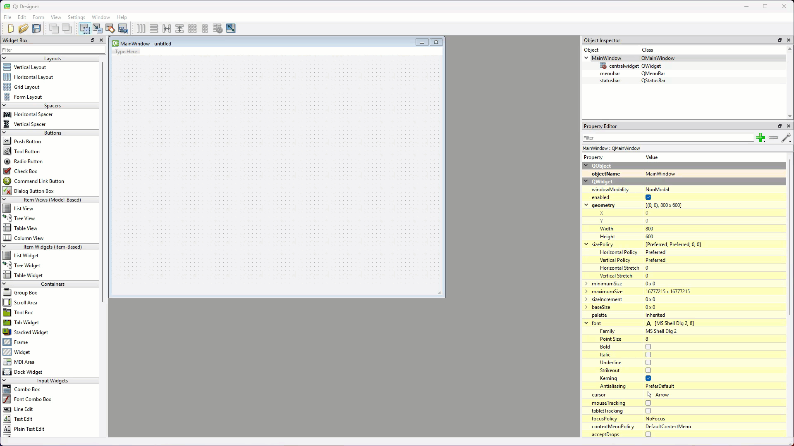
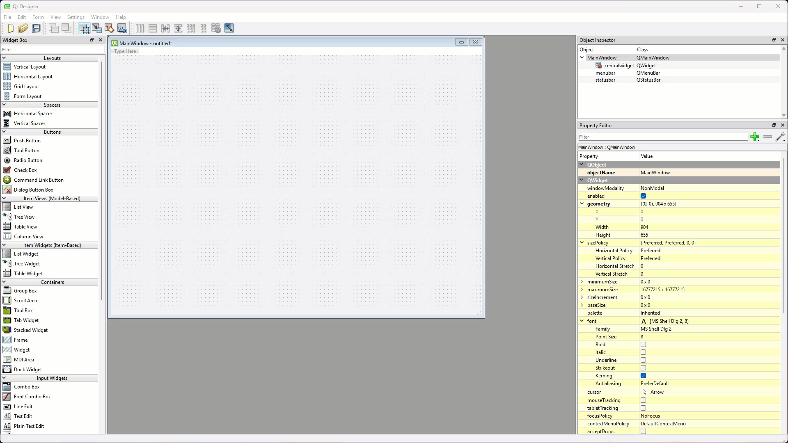
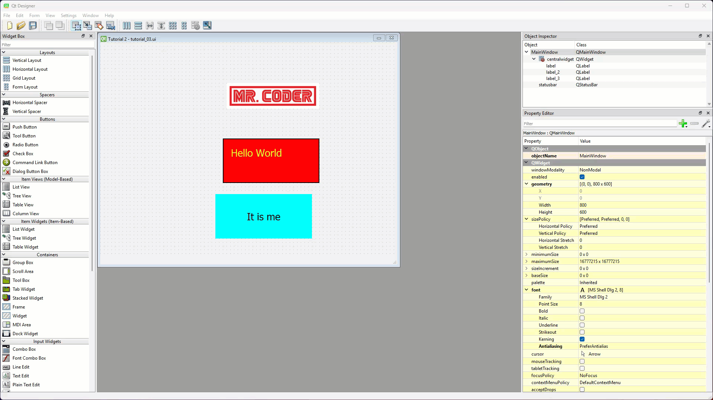
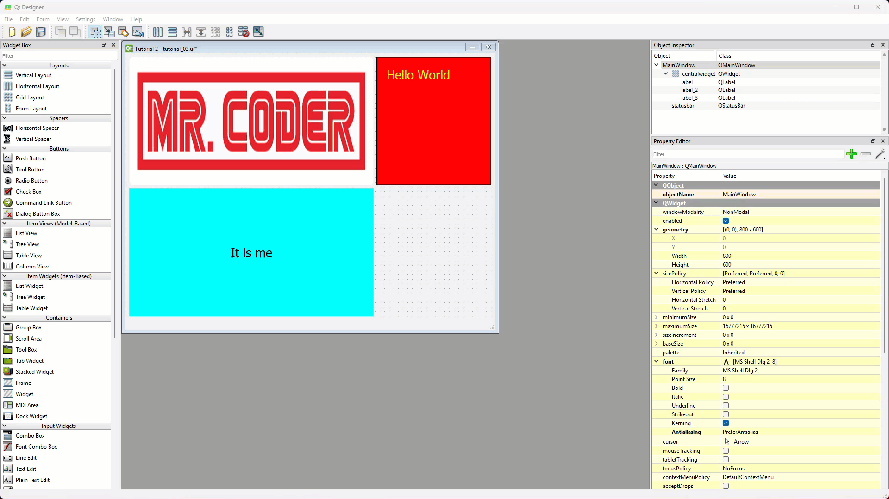

# Tutorial 3 - Layouts

!!! learn "In this tutorial we will learn"
    - the difference between static and dynamic UIs
    - what Qt layouts are, and the four types Qt provides
    - how to apply the first layout to a window, and add later layouts and widgets
    - how horizontal, vertical and grid layouts arrange widgets

!!! terms "Terminology"
    - **static UI** – a user interface whose widgets keep the same size and position when the window is resized.
    - **dynamic UI** – a user interface whose widgets move and resize to fit the window.
    - **layout** – a Qt widget that automatically arranges the widgets inside it, such as in a row, a column or a grid.
    - **nesting** – placing one layout inside a cell of another layout to build a more complex UI.
    - **accessibility** – the usability principle that a digital solution can be used by as many people as possible, on different devices and with different abilities.

## Static vs dynamic UIs

A **static UI** doesn't change when the window is resized. For example, if we run the app from [Tutorial 2](02_labels.md) and resize the window, the labels don't respond.



All three labels:

- stay the same distance from the top-left corner (coordinate `0, 0`)
- stay the same size

A **dynamic UI** changes to fit the window.

### Which should we use?

A static UI only works when the window never changes size, and that's rarer than it seems. Even a window that fills the screen changes size with the screen's resolution. So for most apps, a dynamic UI is the best option.

!!! tip "Digital Solutions link"
    A UI that adapts to different window and screen sizes is easier for everyone to use, which links to the **accessibility** usability principle. See [Usability](https://damom73.github.io/digital-solutions-text-2025/usability-principles) in the Digital Solutions text.

## What are Qt layouts?

**Layouts** arrange the widgets in a window for us. Instead of setting the size and position of every widget by hand, a layout lines them up neatly and keeps them arranged when the window is resized.

Qt has four layouts:

- **Horizontal Layout**: widgets in a row, from left to right.
- **Vertical Layout**: widgets in a column, from top to bottom.
- **Grid Layout**: widgets in rows and columns, like a table.
- **Form Layout**: labels paired with input boxes, for building forms.

Layouts can be **nested**: one layout can go inside a cell of another. That's how we build complex UIs that still look clean and adapt to different screen sizes. In this tutorial we'll explore the first three layouts.

## Applying layouts in Qt Designer

There are two ways to apply a layout in Qt Designer:

- right-click the window (or a widget) and choose a layout from the **Lay out** menu
- drag a layout from the **Layouts** section of the Widget Box

Which way works best depends on whether it's the first layout in the window or a later one. The first layout is applied to the window itself; later layouts are nested inside the first one.

### The first layout

If we drag and drop the first layout, it doesn't get the window's resizing settings, so the UI stays static.



But in an empty window the right-click layout options are greyed out.



The trick is to put some widgets in the window first, then right-click the window to choose the first layout.

### Later layouts

Later layouts can be added either way. These tutorials use drag and drop, but feel free to explore the right-click options too.

## Exploring Qt layouts

To save time, we'll start with the UI from the last tutorial.

1. In Qt Designer, open ***tutorial_02.ui*** (it's in **File** → **Recent Forms**).
2. Change **windowTitle** to **Tutorial 3**.
3. Choose **File** → **Save As...** and save it as ***tutorial_03.ui***.
    - Why: saving a copy keeps ***tutorial_02.ui*** as it was.

Now let's try each layout. After each one, preview the window with **Form** → **Preview** (++ctrl+r++, or ++cmd+r++ on macOS) and resize it.

### Horizontal layout

1. Right-click the window canvas and choose **Lay out** → **Lay Out Horizontally**.

    

Notice that:

- each cell is as tall as the window
- the row fills the width of the window
- each cell's width depends on its content

### Vertical layout

1. Undo the horizontal layout (++ctrl+z++).
2. Right-click the window canvas and choose **Lay out** → **Lay Out Vertically**.

    

Notice that:

- each cell is as wide as the window
- the column fills the height of the window
- each cell's height depends on its content

### Grid layout

1. Undo the vertical layout.
2. Right-click the window canvas and choose **Lay out** → **Lay Out in a Grid**.

    

Notice that:

- it starts out looking like the vertical layout, but we can drag widgets beside, above or below other widgets to build a table
- cell heights and widths both depend on the window size
- cells in the same row share the same height
- cells in the same column share the same width

### Adding more widgets

To add another widget, drag it from the Widget Box onto a cell in the layout. A red line or box shows where it will go, and the new widget takes on the size of that cell.



## Nesting layouts

Remember that layouts are widgets too, so a layout can go in a cell of another layout. That's how we build complex UIs, and we'll do it in the next tutorial. It's also why it's worth planning a UI before building it, so we know where each layout needs to go.

## Testing

Save ***tutorial_03.ui*** with the layout we like best, then convert and run it:

```text
pyuic6 -o ui_main_window.py -x tutorial_03.ui
```

Check that the labels resize and move when we resize the window.

## Exercises

### Exercise 1

Can you use a grid layout to arrange six labels in two rows of three, with each label showing a different colour background? Preview it and check that every row and column resizes evenly.
