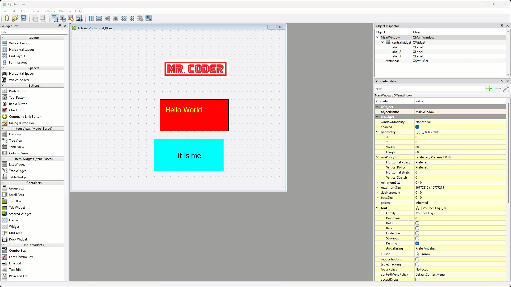
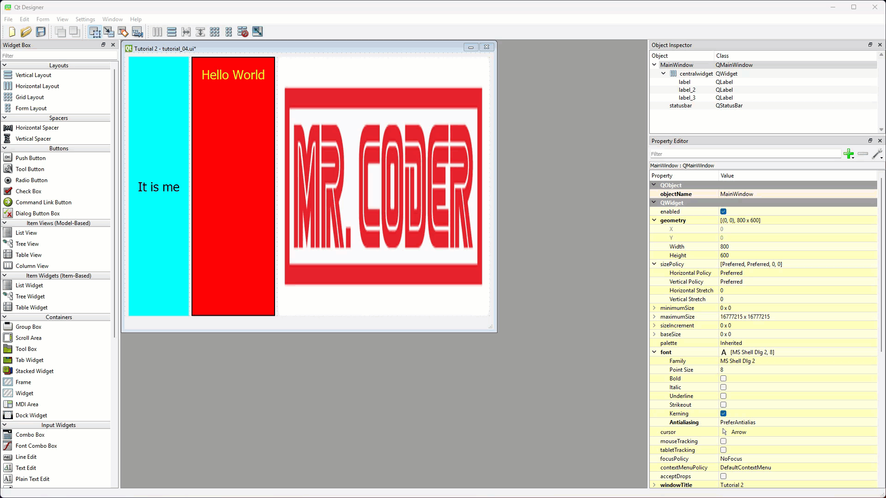
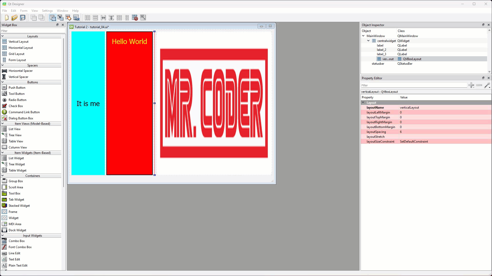
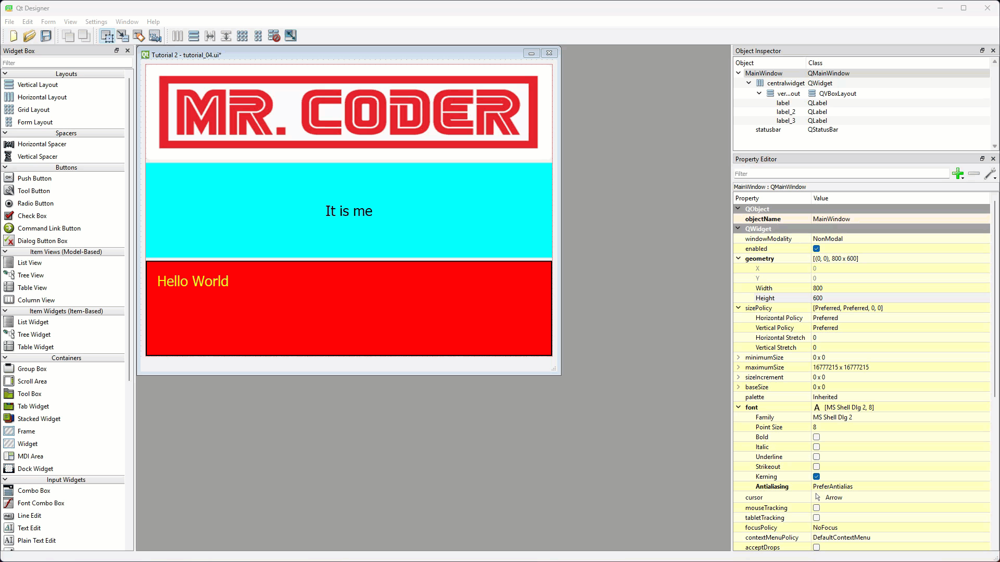
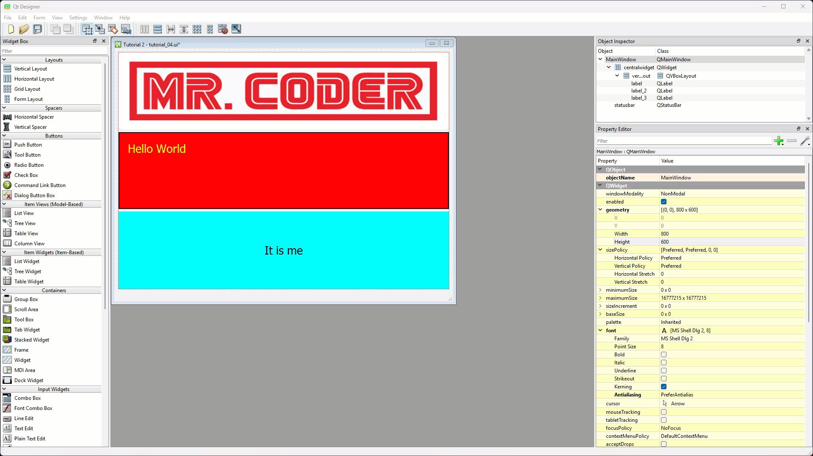
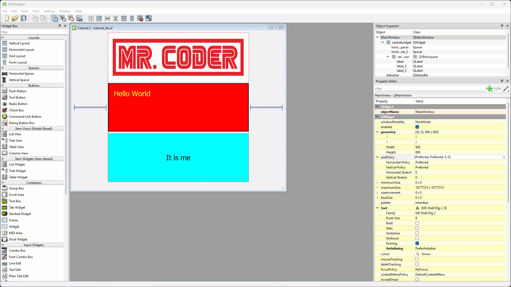

# Tutorial 4 - Complex UIs

!!! learn "In this tutorial we will learn"
    - how to nest a vertical layout inside a horizontal layout
    - how to move widgets into a layout with the Object Inspector
    - how spacers control the way a dynamic UI expands
    - how to preview a window in Qt Designer

!!! terms "Terminology"
    - **spacer** – an invisible widget that pushes other widgets apart in a layout, like a spring.

To make more complex UIs we need to nest layouts and use spacers. In this tutorial we'll give the main window a horizontal layout, put a vertical layout in its centre cell to hold our labels, and use spacers to control how the window expands.

## Nesting layouts

To apply the first layout, we need a window that already has widgets in it, so we'll start from Tutorial 2 again.

1. Open ***tutorial_02.ui*** (**File** → **Recent Forms**), change **windowTitle** to **Tutorial 4**, and save it as ***tutorial_04.ui*** (**File** → **Save As...**).

### Add the horizontal layout

1. Right-click the window canvas and choose **Lay out** → **Lay Out Horizontally**.

    

### Add the vertical layout

1. Drag a **Vertical Layout** from the Widget Box onto the window canvas, between two of the labels.
    - Result: the vertical layout appears as a thin red line, because it's empty.

    

### Move the labels

The vertical layout has shrunk to a line, so we can't drop labels on it in the window canvas. Fortunately we can drag widgets around in the **Object Inspector** too.

1. In the **Object Inspector**, drag each label onto the **QVBoxLayout**.
    - Result: the three labels are indented under **QVBoxLayout**, which shows they are inside it.

    

### Arrange the labels

Inside the vertical layout, we can drag the labels into a new order. A blue bar shows where a label will go.

1. Drag the labels into the order below: the image first, then **Hello World**, then **It is me**.

    

## Spacers

So far our UI doesn't look very different to a single vertical layout. But the nested layouts let us use **spacers** to change how the UI behaves.

A spacer adds empty space between widgets in a layout. Spacers act like invisible springs that push widgets apart, so we can keep widgets together, centre them, or push them to one edge of the window. Qt has two types:

1. **Horizontal Spacer**: pushes widgets apart left to right.
2. **Vertical Spacer**: pushes widgets apart top to bottom.

Spacers matter most in dynamic UIs. For example, a spacer can keep a button in the bottom-right corner however big the window gets.

### Add horizontal spacers

1. Drag a **Horizontal Spacer** from the Widget Box to the left of the labels, and another to the right of them.
    - Result: the centre cell shrinks to its smallest size, and the spacers share the rest of the space evenly.

    

### Add a vertical spacer

1. Drag a **Vertical Spacer** to just below the labels, inside the vertical layout.
    - Result: the labels shrink to their smallest height, and the rest of the window below them is empty.

    

## Preview the window

1. Choose **Form** → **Preview** (++ctrl+r++, or ++cmd+r++ on macOS) and resize the preview window.
    - Result: the labels stay at their smallest size, in the top centre of the window.

Have a play with the spacers: move them, add more and take some away, then preview the window again to see what each change does.

## Testing

Save ***tutorial_04.ui***, convert it and run ***main_window.py***:

```text
pyuic6 -o ui_main_window.py -x tutorial_04.ui
```

Check that the labels stay together in the top centre of the window as we resize it.

## Exercises

### Exercise 1

Can you design a login window with **Username** and **Password** labels beside two **Line Edit** boxes, and a **Log in** button that stays in the bottom-right corner when the window is resized? Use nested layouts and spacers, and preview the window at several sizes.
