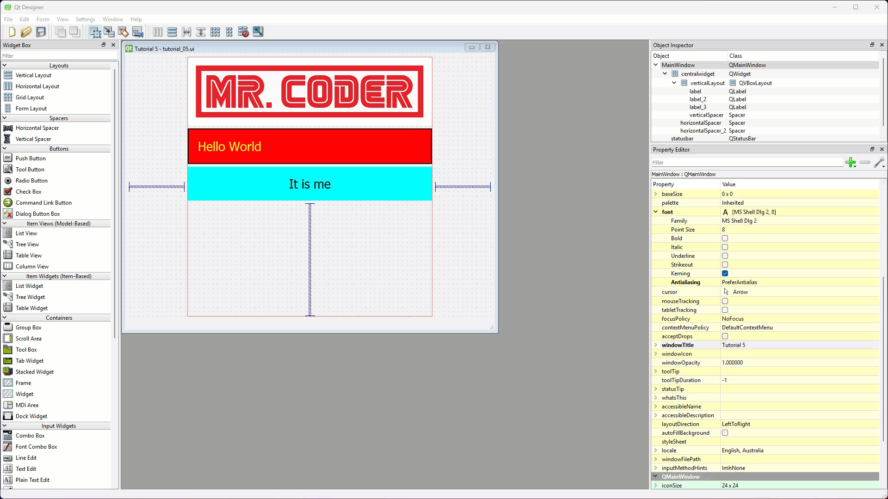
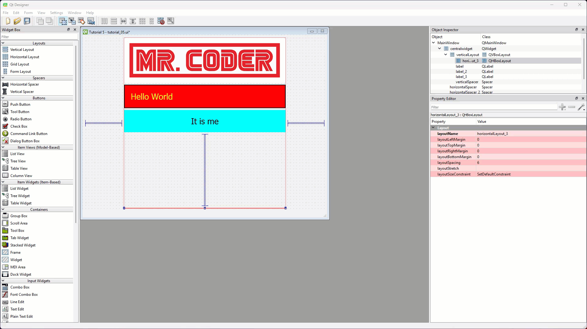
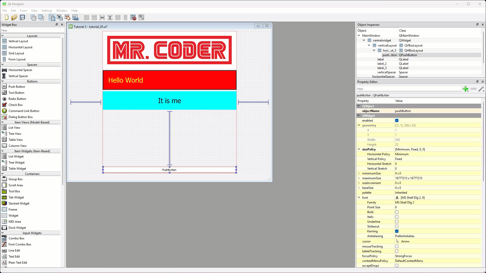
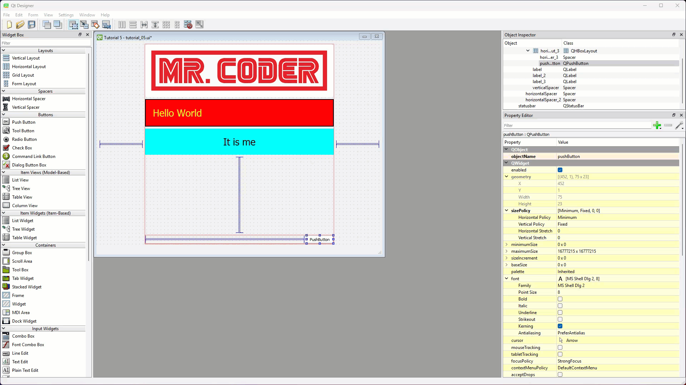
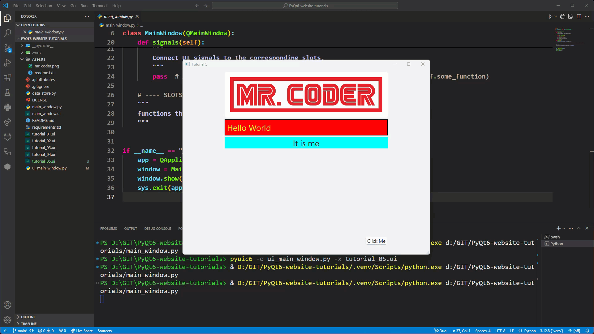
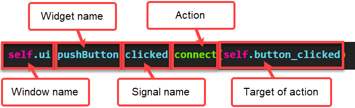
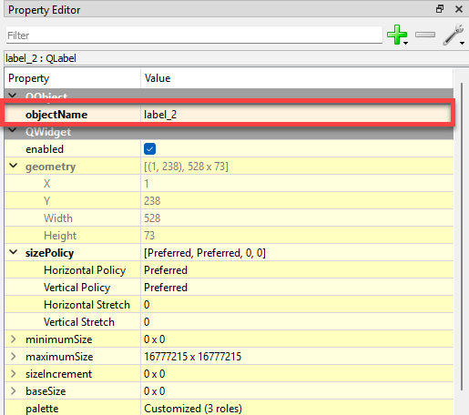

# Tutorial 5 - Signals and Slots

!!! learn "In this tutorial we will learn"
    - how to add a push button to a UI
    - how the boilerplate code is organised
    - how Qt's signals and slots make a UI respond to the user
    - our three-step process for connecting a signal to a slot

!!! terms "Terminology"
    - **push button** – a widget that the user clicks to make something happen.
    - **event-driven programming** – a style of programming where the program keeps checking for things to happen and then responds to them.
    - **event** – something that happens which the program needs to respond to, such as a button being pressed, which the main loop listens for and then handles.
    - **signal** – a message a Qt widget sends when an event happens to it, such as a button's `clicked` signal.
    - **slot** – a method that runs in response to a signal, so it acts as the signal's event handler.
    - **placeholder** – code that does nothing, such as `pass`, used to fill a gap until we write the real code.

So far our tutorials have focused on building a dynamic UI. That's an important foundation, but all our UIs can do is display information. In this tutorial we'll start making our UI interactive, so it responds to the user.

## Push buttons

The first input widget we'll use is the **push button**. It simply registers when the user clicks it, and it's probably the most common component in any UI.

### Tutorial file

We'll add the push button to the UI from the last tutorial.

1. In Qt Designer, open ***tutorial_04.ui***, change **windowTitle** to **Tutorial 5** and save it as ***tutorial_05.ui***.

### Add a push button

We want the button on the right of the window, under the labels, so first we need a horizontal layout for it.

1. Drag a **Horizontal Layout** to the bottom of the vertical layout in the window canvas.

    

2. The new layout is squashed, so drag a **Push Button** onto the **QHBoxLayout** in the **Object Inspector** instead.
    - Result: the button stretches across the whole width of the layout.

    

3. Drag a **Horizontal Spacer** to the left of the push button.
    - Result: the spacer pushes the button to the right.

    

4. Double-click the button, type **Click Me**, and set its **font** → **Point Size** to `12`.

    

### Save, convert and run

1. Save ***tutorial_05.ui***.
2. In the VS Code terminal, convert it:

    ```text
    pyuic6 -o ui_main_window.py -x tutorial_05.ui
    ```

3. Run ***main_window.py***.



The button already behaves the way buttons should: it highlights when the mouse is over it and changes colour when clicked. But it doesn't **do** anything. That's where signals and slots come in.

---

## Signals and slots

GUI apps use **event-driven programming**. Instead of running from top to bottom and finishing, the app waits for **events** (a click, a key press, a timer running out) and runs code in response.

In Qt, events are handled with **signals and slots**:

- A **signal** is a message a widget sends when an event happens to it. For example, a push button sends a `clicked` signal when it's clicked.
- A **slot** is a method that runs when a signal it's connected to is sent. It's the signal's event handler.

Every Qt widget has signals. Over these tutorials we'll use the most useful ones, and the [Qt documentation](https://doc.qt.io/qt-6/) lists the rest.

!!! tip "Digital Solutions link"
    Events, event handlers and the event loop are part of event-driven programming in the syllabus. See [Programming paradigms](https://damom73.github.io/digital-solutions-text-2025/paradigms) in the Digital Solutions text.

### The boilerplate code

Before we add any code, let's look at how ***main_window.py*** is organised. It's our boilerplate, so we'll see this structure in every app we build.

```python linenums="1" title="main_window.py"
--8<-- "examples/basics/05_signals_slots/step01/main_window.py"
```

??? note "Code explanation"
    - **lines 1–2** → import `sys` (so the app can read command-line arguments and exit cleanly) and the two Qt classes every app needs: `QApplication` and `QMainWindow`.
    - **line 3** → imports `Ui_MainWindow`, the view class that `pyuic6` builds in ***ui_main_window.py***.
    - **line 6** → defines our `MainWindow` class as a subclass of `QMainWindow`, so it is a window with everything a Qt main window has. This class is our controller.
    - **line 7** → defines `__init__`, which runs when the window is created.
    - **lines 8–10** → a docstring that explains what `__init__` does.
    - **line 11** → runs `QMainWindow`'s own `__init__`, so the window is set up properly before we add to it.
    - **lines 12–13** → create the view and build all its widgets inside our window. After this, every widget is available through `self.ui`, for example `self.ui.label_2`.
    - **line 18** → calls the `signals` method, so all our signals are connected as soon as the window is created.
    - **line 20** → defines the `signals` method. This is where we connect signals to slots.
    - **lines 21–23** → a docstring that explains what `signals` is for.
    - **line 24** → a `pass` placeholder, because a method can't be empty. We'll replace it with our connections.
    - **lines 27–29** → a string that marks where the slot methods go.
    - **line 32** → only runs the code below when this file is run directly, not when it's imported.
    - **line 33** → creates the `QApplication`, which runs the **event loop** that waits for events and sends signals.
    - **lines 34–35** → create our window and show it on the screen.
    - **line 36** → starts the event loop with `app.exec()`, and exits the program cleanly when the window is closed.

Signals and slots can technically go anywhere in the class, but keeping signal connections in `signals` and slot methods under `# ---- SLOTS ---- #` makes our code easier to maintain.

### Our process

We'll use the same three steps every time we connect a signal to a slot:

1. create a placeholder for the slot
2. connect the signal to the slot
3. write the slot's code

Creating the slot first is a good habit: when we type the connection in step 2, VS Code suggests the slot's name, which avoids typos.

!!! tip "Using suggested code"
    Accepting VS Code's suggestions speeds up coding, and more importantly it prevents typing errors. VS Code only suggests names that exist, so we can't connect to a slot that isn't there.

### Copy main_window.py

We want to keep a clean copy of the boilerplate to reuse in every tutorial, so we'll work in a copy.

1. In VS Code's file panel, right-click ***main_window.py***, choose **Copy**, then right-click in the file panel and choose **Paste**.
2. Rename the copy ***first_program.py*** (right-click → **Rename**).
    - Result: ***first_program.py*** has exactly the same code as ***main_window.py***.

### 1. Create the slot placeholder

Open ***first_program.py***, replace the string under `# ---- SLOTS ---- #` with the highlighted code below, and save it.

```python linenums="1" hl_lines="27-28" title="first_program.py"
--8<-- "examples/basics/05_signals_slots/step02/first_program.py"
```

??? note "Code explanation"
    - **line 27** → defines the `button_clicked` slot. It's a method of our window, so its first parameter is `self`.
    - **line 28** → a `pass` placeholder, so the method isn't empty and VS Code doesn't show an indentation error.

### 2. Connect the signal

Replace the `pass` line in the `signals` method with the highlighted code below.

```python linenums="1" hl_lines="24" title="first_program.py"
--8<-- "examples/basics/05_signals_slots/step03/first_program.py"
```

??? note "Code explanation"
    - **line 24** → connects the `clicked` signal of the push button to our `button_clicked` slot, so `button_clicked` runs every time the button is clicked.

Let's break that line down:



- **window name**: `self.ui`, the view we created in `__init__`
- **widget name**: `pushButton`, the widget whose signal we're using (its **objectName** in Qt Designer)
- **signal name**: `clicked`, the signal that triggers the action
- **action**: `connect`, which links the signal to a slot
- **target of the action**: `self.button_clicked`, the slot to run (with no brackets, because we're naming the method, not calling it)

### 3. Write the slot's code

When the button is clicked, we want to change the text of the label above it. Replace the `pass` in `button_clicked` with the highlighted code below.

```python linenums="1" hl_lines="28" title="first_program.py"
--8<-- "examples/basics/05_signals_slots/step04/first_program.py"
```

??? note "Code explanation"
    - **line 28** → calls the label's `setText` method, which changes its **text** property to `I'm clicked`.

!!! tip "Widget properties"
    Every property we can set in Qt Designer can also be changed by our code while the app runs, usually with a method that starts with `set`, such as `setText` or `setStyleSheet`. The [Qt documentation](https://doc.qt.io/qt-6/) lists them all.

!!! primm "PRIMM"
    1. **Predict** what will happen when you click **Click Me**. What will happen if you click it a second time?
    2. **Run** ***first_program.py*** and click the button.
    3. **Investigate**: change `"I'm clicked"` to another message, run it again, and check which label changes.

!!! warning "The wrong label changes?"
    Qt Designer names labels in the order they were added, so `label_2` might not be the label we expect. If the wrong label changes:

    1. open ***tutorial_05.ui*** in Qt Designer
    2. click the label we want to change
    3. check its **objectName** at the top of the Property Editor

        

    4. change `label_2` in ***first_program.py*** to that name

## Commit and push

We've finished and tested a new feature, so let's save it to GitHub.

1. In GitHub Desktop, type **Added signals and slots** in the **Summary** box.
2. Click **Commit to main**.
3. Click **Push origin**.

We've learnt how to add push buttons and furthered our understanding of nested layouts. We then used Qt's interactivity mechanism, **signals and slots**, to connect a button's signal to a slot that changes the text of a label.

## Exercises

!!! primm "PRIMM"
    Time to **modify** the code and see what happens.

Solutions are on the [Exercise Solutions](../reference/solutions.md#tutorial-5-signals-and-slots) page.

### Exercise 1

Can you add a second push button, **Reset**, that changes the label back to **It is me**? It should:

- sit beside the **Click Me** button, with the objectName `pushButton_reset`
- be connected to a new slot called `reset_clicked`, following our three-step process

Remember to save the UI, convert it again with `pyuic6`, and only then run ***first_program.py***.
