# Tutorial 6 - Create Calculator App

!!! learn "In this tutorial we will learn"
    - how to plan and build a calculator UI with nested layouts
    - how to name widgets so our code can find them
    - how size policies and fonts change the look of an app
    - how Python's `eval()` function can calculate an equation stored in a string
    - how to connect many buttons to their own slots

!!! terms "Terminology"
    - **object name** – the name Qt Designer gives a widget, which our code uses to find it, such as `label_display`.
    - **size policy** – a widget setting that controls how it grows or shrinks when a layout resizes it.
    - **controller file** – the Python file that holds our app's logic and connects the view to the data.

Now that we know how to use labels for output and push buttons for input, we can build a real app: a calculator. It's a great first project, because a calculator is just a display and some buttons, and we already know how to make both.

## Plan the UI

Before opening Qt Designer, let's think about the layout. A calculator has a display along the top and a grid of buttons underneath. So:

- the window gets a **vertical layout** with two cells
- the top cell holds the display label
- the bottom cell holds a **grid layout** of 16 buttons, four rows of four

## Create the UI

Open Qt Designer and create a new **Main Window**.

### Format the main window

1. Remove the **menu bar** and the **status bar** (right-click each one).
2. Set **geometry** → **Width** to `400` and **Height** to `500`.
3. Set **windowTitle** to **Calculator**.

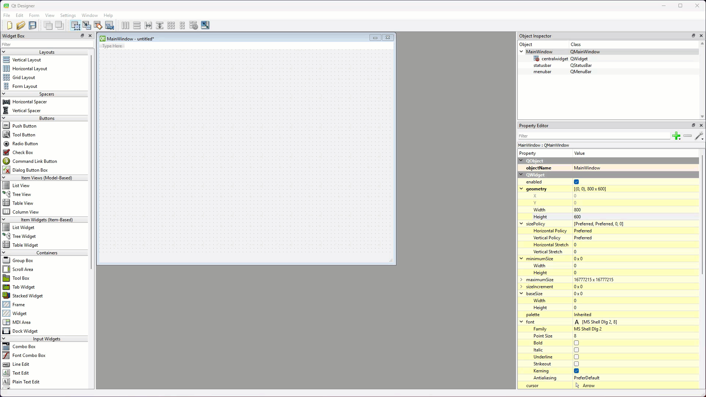

### Display label

1. Drag a **Label** onto the window canvas, then right-click the canvas and choose **Lay out** → **Lay Out Vertically**.

    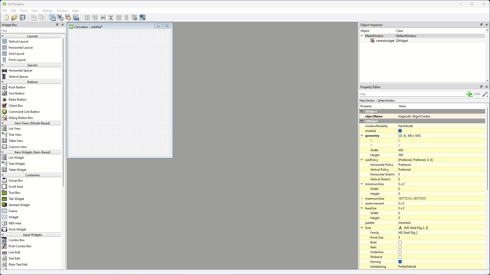

2. At the top of the Property Editor, change the label's **objectName** to `label_display`.

    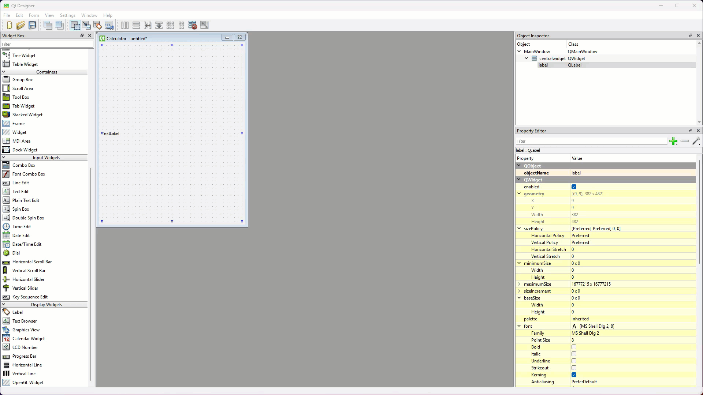

!!! tip "Widget names"
    All but the simplest UIs have lots of widgets, so we need to keep track of them. Some suggested conventions:

    - Only rename widgets that our code will use, either to get input from them or to show output in them. If a label never changes, there's no need to name it.
    - Start each name with the type of widget. In our Python code we can't see whether a name is a label or a button, so the name needs to tell us. These tutorials use Qt Designer's own prefixes (`label_`, `pushButton_`).
    - We can choose our own convention instead (for example `lbl_display`), as long as we use it consistently.

3. Set the label's **font** → **Family** to **Consolas** (macOS: **SF Mono** or **Menlo**) and **Point Size** to `40`, and set **alignment** → **Horizontal** to **AlignRight**.

    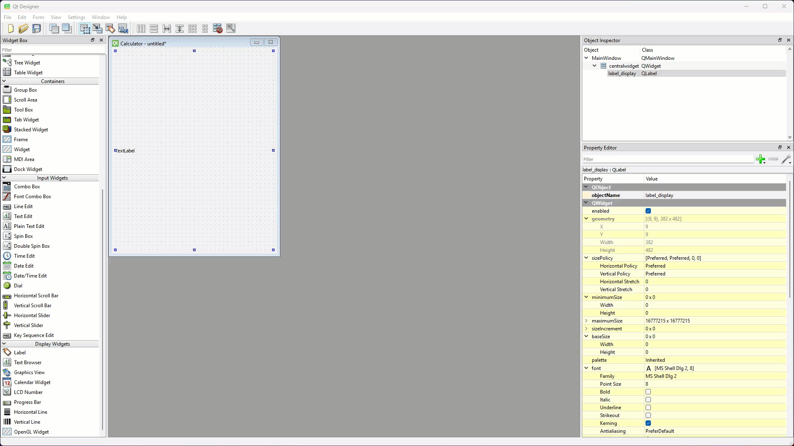

### Buttons

To save time, we'll add and format one button, then copy it. Copies keep the original's formatting.

1. Drag a **Grid Layout** onto the window canvas under `label_display`.

    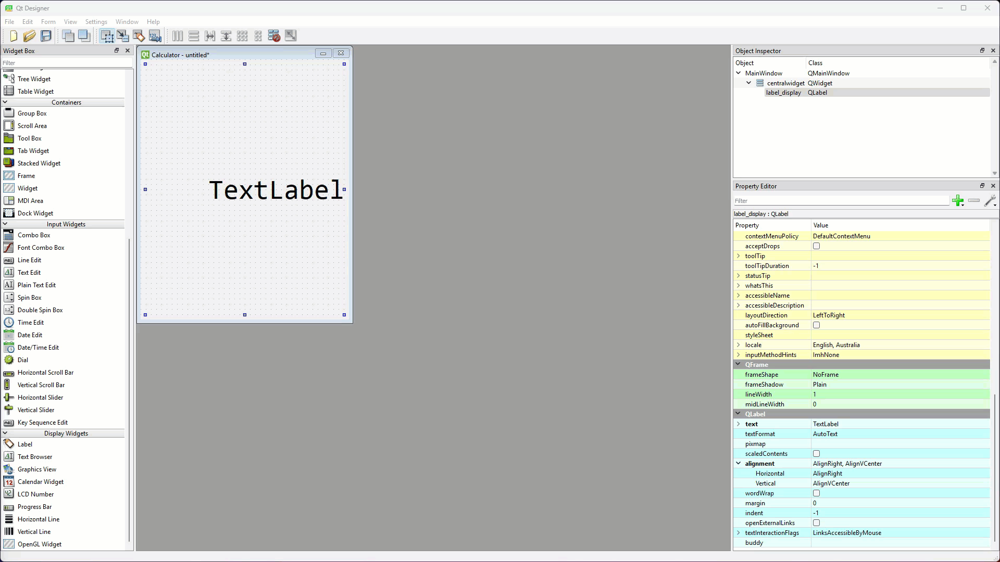

2. Drag a **Push Button** into the red box of the grid layout, then set its properties:

    | Property | Value |
    | --- | --- |
    | objectName | `pushButton_7` |
    | sizePolicy → Horizontal Policy | **MinimumExpanding** |
    | sizePolicy → Vertical Policy | **MinimumExpanding** |
    | font → Family | **Consolas** (macOS: **SF Mono** or **Menlo**) |
    | font → Point Size | `20` |
    | text | `7` |

    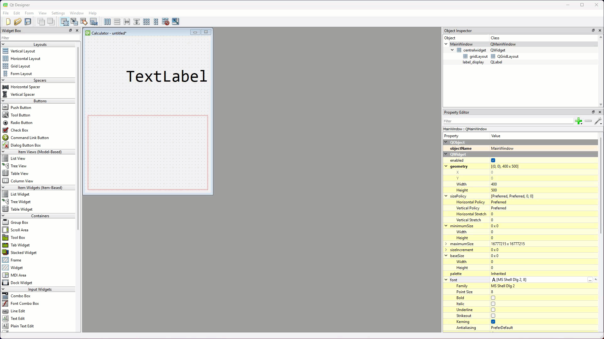

!!! tip "Size policy"
    A widget's **size policy** tells a layout how the widget behaves when the layout resizes it. It has a horizontal part and a vertical part.

    | Policy | Behaviour |
    | --- | --- |
    | Fixed | Stays the same size. It never shrinks or grows. |
    | Minimum | Can grow, but never shrinks below its preferred size. |
    | Maximum | Can shrink, but never grows above its preferred size. |
    | Preferred | Prefers its preferred size, but can shrink or grow. |
    | Expanding | Prefers to grow and take as much space as it can. |
    | MinimumExpanding | Never shrinks below its preferred size, and grows to take as much space as it can. |
    | Ignored | Ignores its preferred size and takes whatever space it's given. |

    We use **MinimumExpanding** so the buttons fill the window, which makes them big targets to click.

3. Hold ++ctrl++ (++cmd++ on macOS) and drag `pushButton_7` to the right to copy it. Check the copy's objectName is `pushButton_8` and change its text to `8`.

    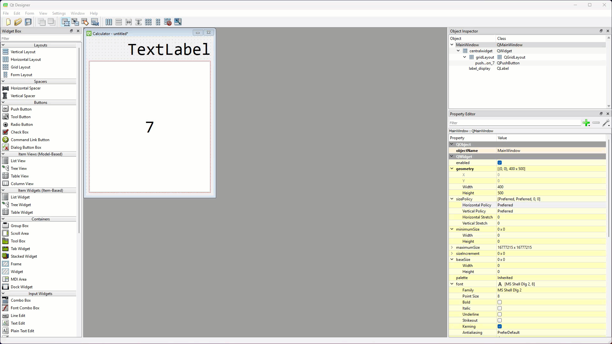

4. Copy the button until the grid matches the picture and table below.

    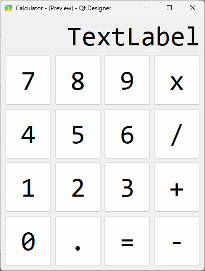

    | First column | Second column | Third column | Fourth column |
    | --- | --- | --- | --- |
    | `pushButton_7` | `pushButton_8` | `pushButton_9` | `pushButton_multiply` |
    | `pushButton_4` | `pushButton_5` | `pushButton_6` | `pushButton_divide` |
    | `pushButton_1` | `pushButton_2` | `pushButton_3` | `pushButton_add` |
    | `pushButton_0` | `pushButton_decimal` | `pushButton_equal` | `pushButton_subtract` |

!!! warning "Special characters in names"
    Python names can't contain operators such as `*`, `/`, `+`, `-` or `=`, so we spell them out in the button names. For example, the **x** button is `pushButton_multiply`.

5. Finally, change `label_display`'s text to `0`.

    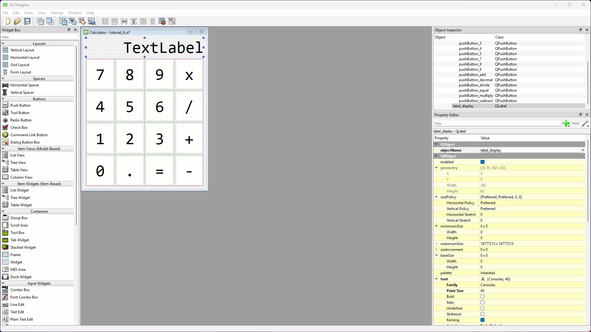

Now it really looks like a calculator.

### Save and convert

This time we'll give the Python view file its own name, so later tutorials don't overwrite it.

1. Save the UI in your repo as ***calculator.ui***.
2. In the VS Code terminal, convert it to ***ui_calculator.py***:

    ```text
    pyuic6 -o ui_calculator.py -x calculator.ui
    ```

---

## Write the code

Now it's time to work on the controller.

### Create the controller file

We want our **controller file** to have a meaningful name.

1. Copy ***main_window.py*** and rename the copy ***calculator.py***.
2. Run ***calculator.py***.
    - Result: the wrong UI appears. It's the UI from our last tutorial.

    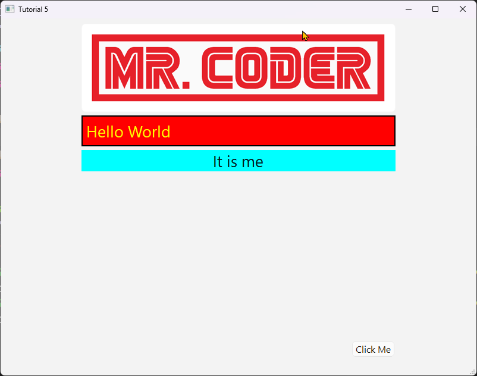

That's because ***calculator.py*** still imports its view from ***ui_main_window.py***. Let's fix that.

3. Change line 3 to the highlighted code below.

```python linenums="1" hl_lines="3" title="calculator.py"
--8<-- "examples/calculator/06_create/step01/calculator.py"
```

??? note "Code explanation"
    - **line 3** → imports `Ui_MainWindow` from ***ui_calculator.py*** (the calculator's view) instead of ***ui_main_window.py***.

!!! primm "PRIMM"
    1. **Predict** what will appear this time.
    2. **Run** ***calculator.py***.
    3. **Investigate**: click some buttons. Why doesn't anything happen?

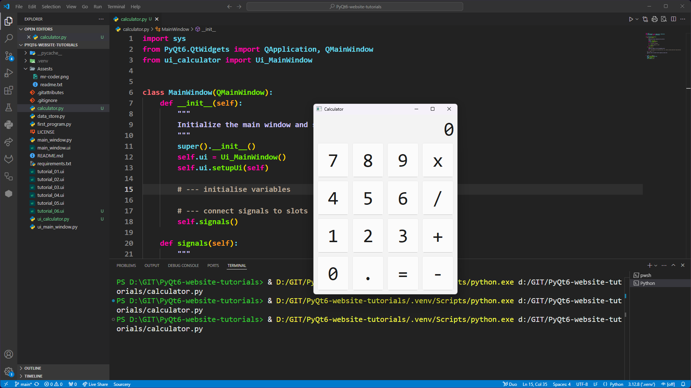

### How our calculator will work

Now that our UI works, let's work out how the controller will calculate answers. We'll use one of Python's built-in functions, `eval()`. It takes a string holding a Python expression, works it out and returns the result. For example:

```python
print(eval("3+2"))
```

prints `5`.

So here's the plan:

1. every time a number or operator button is clicked, add its character to the end of an equation string
2. show the equation string on the display
3. when `=` is clicked, use `eval()` to work out the answer

It will get a bit more complicated, but this is a good starting point.

!!! tip "String methods"
    Strings are a big part of most programs, so it pays to know the ways we can work with them. [W3Schools' Python String Methods page](https://www.w3schools.com/python/python_ref_string.asp) lists all the built-in string methods.

### Create the equation variable

We need a variable to store our equation as we build it. The boilerplate has a section in `__init__` for variables, so we'll put it there.

Open ***calculator.py*** and add the highlighted code below.

```python linenums="6" hl_lines="11" title="calculator.py"
--8<-- "examples/calculator/06_create/step02/calculator.py:6:30"
```

??? note "Code explanation"
    - **line 16** → creates `self.equation` as an empty string. We'll add a character to it every time a button is clicked. Using `self.` makes it an attribute of the window, so every method can use it.

### The 9 button

We'll use our three-step process from [Tutorial 5](../basics/05_signals_slots.md#our-process). Every button except `=` will add its character to `self.equation`, so let's start with the **9** button.

First, create the slot placeholder under the slots string.

```python linenums="21" hl_lines="11-12" title="calculator.py"
--8<-- "examples/calculator/06_create/step03/calculator.py:21:33"
```

??? note "Code explanation"
    - **line 31** → defines the `nine_clicked` slot.
    - **line 32** → a `pass` placeholder, so VS Code will suggest `nine_clicked` when we connect the signal.

Next, replace the `pass` line in `signals` with the highlighted connection.

```python linenums="21" hl_lines="5" title="calculator.py"
--8<-- "examples/calculator/06_create/step04/calculator.py:21:33"
```

??? note "Code explanation"
    - **line 25** → connects `pushButton_9`'s `clicked` signal to the `nine_clicked` slot.

Then replace the `pass` in `nine_clicked` with the slot's code.

```python linenums="27" hl_lines="6" title="calculator.py"
--8<-- "examples/calculator/06_create/step05/calculator.py:27:33"
```

??? note "Code explanation"
    - **line 32** → adds `"9"` to the end of `self.equation`. `+=` joins the two strings together.

!!! primm "PRIMM"
    1. **Predict** what will happen on the display when you click **9**.
    2. **Run** ***calculator.py*** and click **9** a few times.
    3. **Investigate**: why doesn't the display change?

Nothing happens on the display, because we haven't told the display about the new value of `self.equation`.

### Update the display

We'll need to update the display after every button click, so rather than repeating the same code in every slot, we'll write it once in its own method and call it from each slot. This method isn't a slot, so it goes in a new section.

Add the highlighted code below `nine_clicked`.

```python linenums="27" hl_lines="8-10" title="calculator.py"
--8<-- "examples/calculator/06_create/step06/calculator.py:27:37"
```

??? note "Code explanation"
    - **line 35** → defines `update_display`, a method our slots can call.
    - **line 36** → sets the display label's text to the current equation.

Now call `update_display` at the end of `nine_clicked`.

```python linenums="27" hl_lines="7" title="calculator.py"
--8<-- "examples/calculator/06_create/step07/calculator.py:27:38"
```

??? note "Code explanation"
    - **line 33** → calls `update_display`, so the display shows the new equation after **9** is added.

!!! primm "PRIMM"
    1. **Predict** what the display will show after you click **9** three times.
    2. **Run** ***calculator.py*** and test it.
    3. **Investigate**: what happens to the `0` that was on the display when the app started?

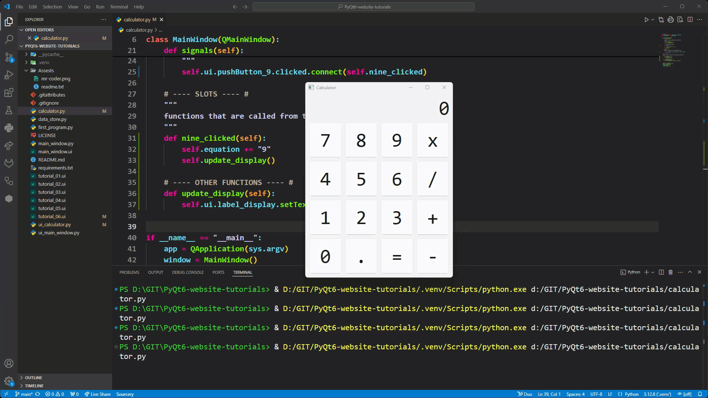

### The other buttons

Now repeat the three steps for every other button **except** `=`. For each button:

1. create its slot placeholder (for example `eight_clicked`)
2. connect its `clicked` signal in `signals`
3. replace `pass` with code that adds its character, then calls `self.update_display()`

The operator buttons add the Python operator, not the symbol on the button: `*` for **x**, `/` for **/**, `+` and `-`. Test each button as we finish it.

??? tip "Check your code"
    After adding every button, ***calculator.py*** should look like this.

    ```python linenums="1" title="calculator.py"
    --8<-- "examples/calculator/06_create/step08/calculator.py"
    ```

!!! primm "PRIMM"
    1. **Predict** what the display will show if you click **1**, **2**, **+**, **3**.
    2. **Run** ***calculator.py*** and check every button adds the right character.
    3. **Investigate**: what does the display show if you click **+** several times in a row? Is that what a calculator should do?

By the end of this tutorial our calculator should work like the example below. In the next tutorial we'll make `=` work and fix the problems we found.

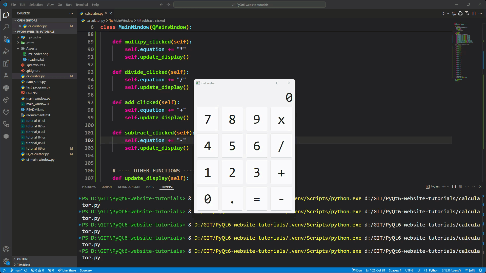

## Commit and push

1. In GitHub Desktop, type **Created calculator UI and buttons** in the **Summary** box.
2. Click **Commit to main**, then **Push origin**.

## Exercises

!!! primm "PRIMM"
    Time to **modify** the code and see what happens.

Solutions are on the [Exercise Solutions](../reference/solutions.md#tutorial-6-create-calculator-app) page.

### Exercise 1

Can you add a **C** (clear) button that clears the equation and puts `0` back on the display? It should:

- be added to ***calculator.ui*** with the objectName `pushButton_clear` (for example in a new row above the number buttons)
- connect to a new `clear_clicked` slot

Remember to convert ***calculator.ui*** again after changing it.
