# Tutorial 16 - Contacts UI

!!! learn "In this tutorial we will learn"
    - how to show data in rows and columns with a table widget
    - how to design a custom dialog box in Qt Designer
    - how a dialog's **OK** and **Cancel** buttons work without any code
    - what CSV files are, and why they're used to share data

!!! terms "Terminology"
    - **table widget** – a widget that shows data in a grid of rows and columns, like a spreadsheet.
    - **custom dialog** – a dialog box we design ourselves in Qt Designer, instead of using one of Qt's ready-made dialogs.
    - **CSV** – short for comma-separated values, a plain-text file format where each line is a row of data and commas separate the values.
    - **proximity** – the visual communication principle of placing related items close together so they are seen as a group.

The ready-made dialog box in our To Do List was helpful, but it can only ask for one piece of text. Sometimes we need a dialog for a very specific job. Fortunately, Qt lets us design our own **custom dialogs**.

We'll explore custom dialogs by building a **Contacts** app. Along the way we'll show data in a table and work with CSV files.

!!! tip "CSV files"
    **CSV** (comma-separated values) files are plain-text files that store data as a table. Each line is a row, and commas separate the values in the row. The first row is often a header row that names the columns. For example:

    ```text
    First Name,Last Name,Phone Number
    Alice,Smith,0428 543 876
    Bob,Johnson,0430 690 367
    ```

    Because they're plain text, CSV files can be opened by spreadsheets, databases and almost every programming language, which makes them a popular way to move data between systems.

We'll design two UIs for this app:

1. **MainWindow**: the contacts table, with a **File** menu and an **Add** button
2. **NewContact**: a dialog where we type a new contact's details

## Main window

### Window settings and menu

1. Create a new **Main Window**. Keep the **menu bar**, leave **geometry** at `800` × `600`, and set **windowTitle** to **Contacts**.

    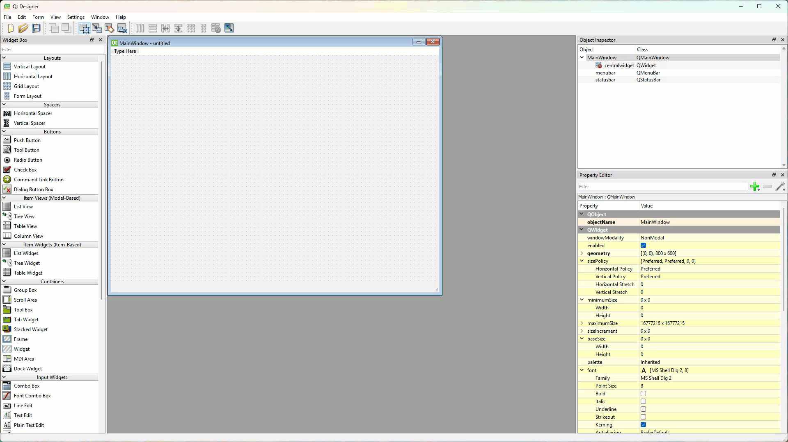

2. Add a **File** menu with two items: **Open** and **Save**.
    - Result: Qt Designer creates the actions `actionOpen` and `actionSave`.

    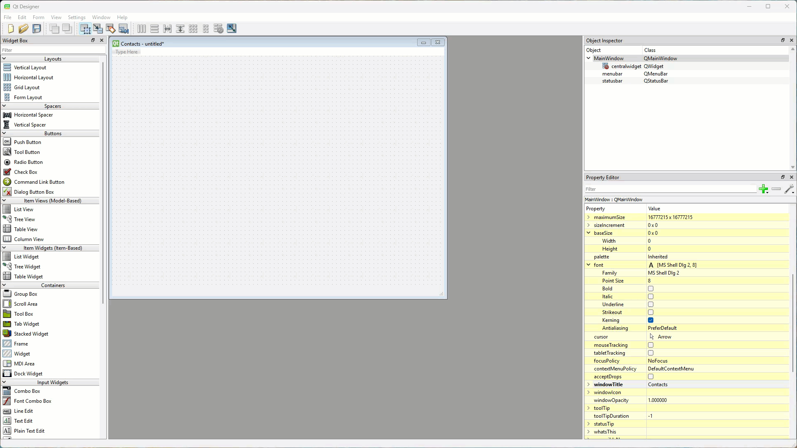

### Layout

1. Drag a **Label** onto the canvas, a **Table Widget** (not the Table View) under it, and a **Horizontal Layout** under that. Right-click the canvas and choose **Lay out** → **Lay Out Vertically**.

    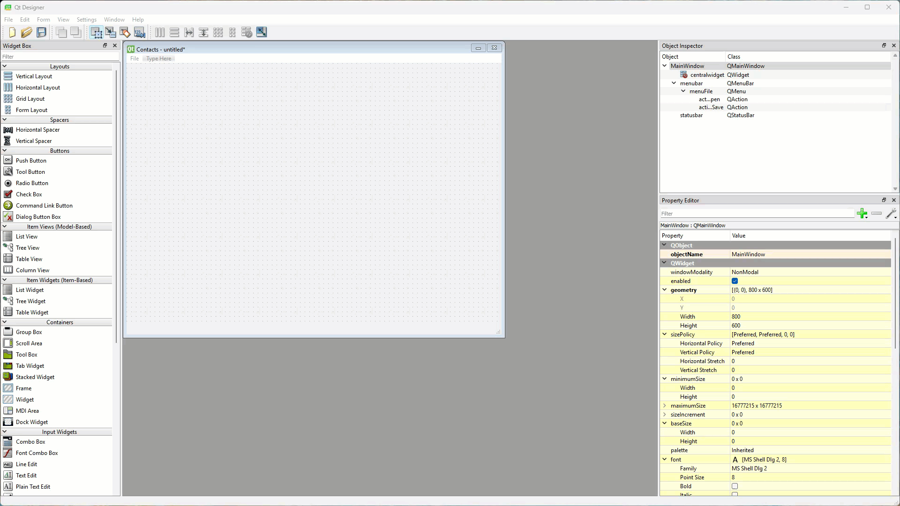

2. Use the **Object Inspector** to put a **Push Button** in the horizontal layout, then drag a **Horizontal Spacer** to its left.

    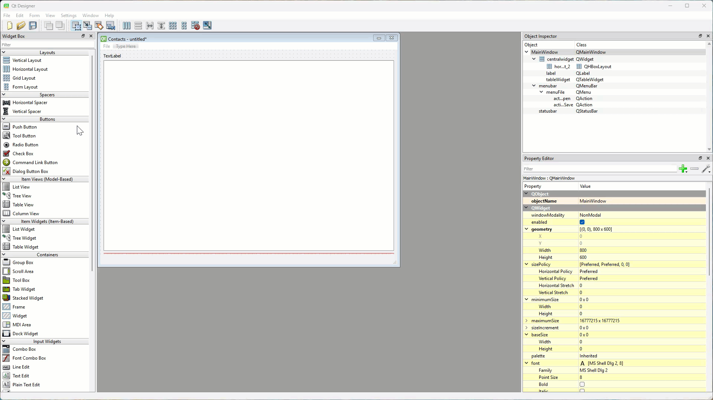

### Widget settings

| Widget | Property | Value |
| --- | --- | --- |
| Label | text | **Contacts List** |
| Label | font → Point Size | `30` |
| Label | alignment → Horizontal | **AlignHCenter** |
| Table Widget | objectName | `tableWidget_contacts` |
| Table Widget | font → Point Size | `20` |
| Push Button | objectName | `pushButton_add` |
| Push Button | text | **Add** |

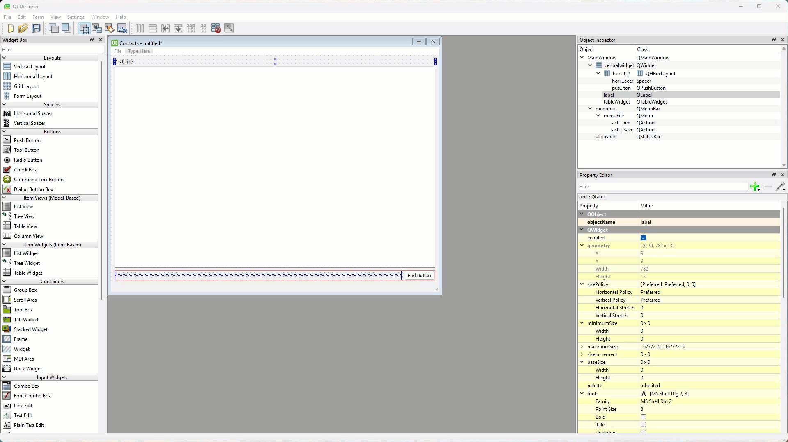

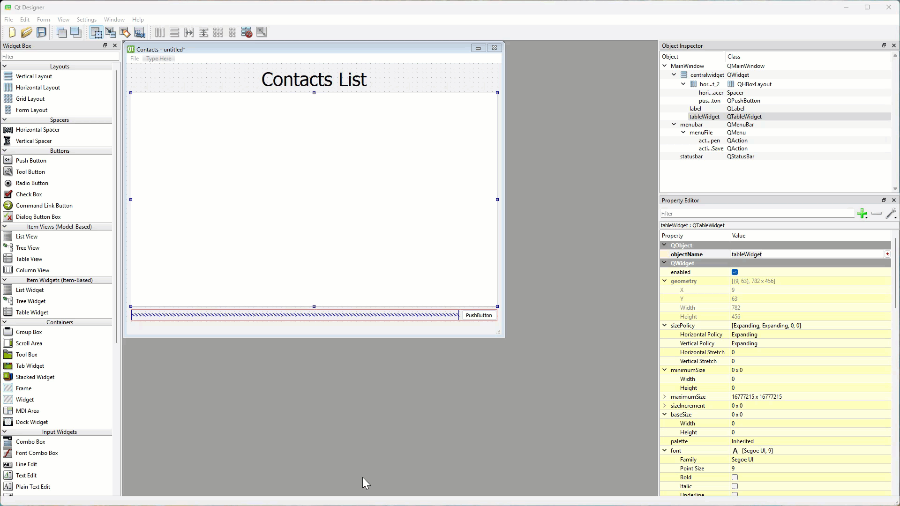


### Save the main window

1. Preview the window, then save it in your repo as ***contacts.ui*** and close it.

## New contact dialog

Now we'll design the dialog we use to add a new contact: first name, last name and phone number.

1. Choose **File** → **New**, select **Dialog with Buttons Bottom** and click **Create**.
    - Result: a dialog opens with **OK** and **Cancel** buttons already in place.

    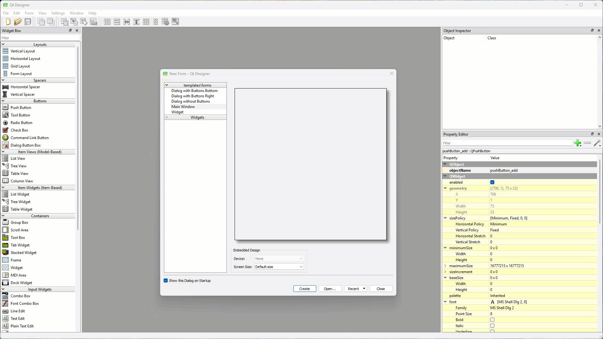

### Layout

1. Leave **geometry** at `400` × `300`, and set **windowTitle** to **Add new contact**.
2. Drag a **Label** onto the canvas and a **Grid Layout** under it. In the grid layout, add three **Labels** in the left column, each with a **Line Edit** beside it.
3. Right-click the canvas and choose **Lay out** → **Lay Out Vertically**, then add a **Vertical Spacer** under the grid layout.

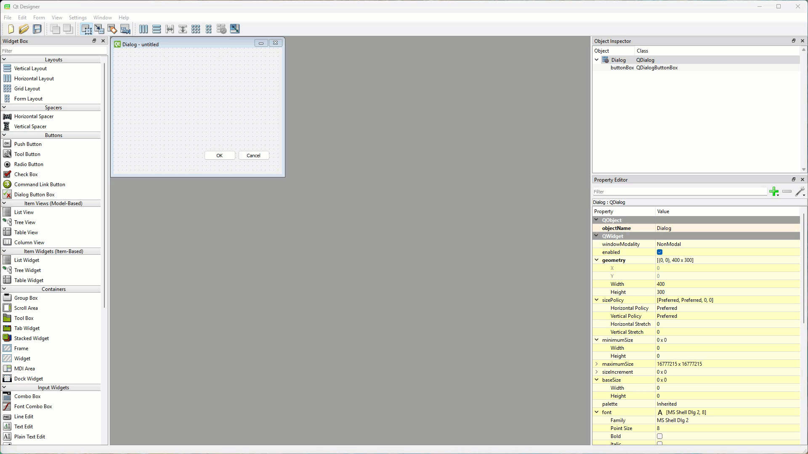

### Widget settings

| Widget | Property | Value |
| --- | --- | --- |
| top label | text | **Contact Details** |
| top label | font → Point Size | `20` |
| top label | alignment → Horizontal | **AlignHCenter** |
| first row label | text, font → Point Size | **First Name**, `14` |
| first row line edit | objectName, font → Point Size | `lineEdit_first_name`, `14` |
| second row label | text, font → Point Size | **Last Name**, `14` |
| second row line edit | objectName, font → Point Size | `lineEdit_last_name`, `14` |
| third row label | text, font → Point Size | **Phone Number**, `14` |
| third row line edit | objectName, font → Point Size | `lineEdit_phone_number`, `14` |

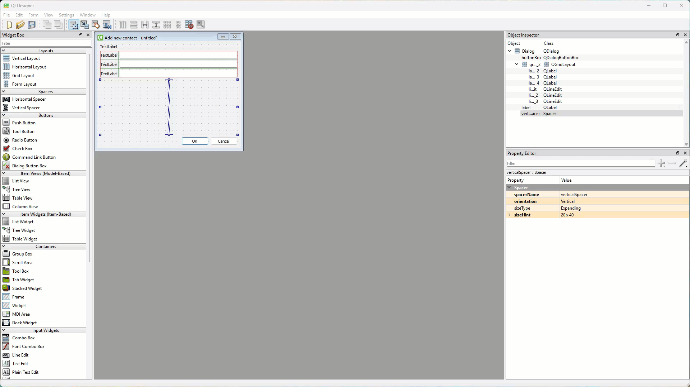

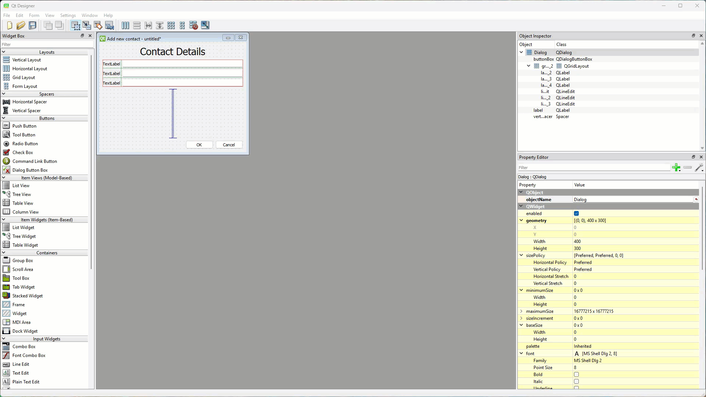

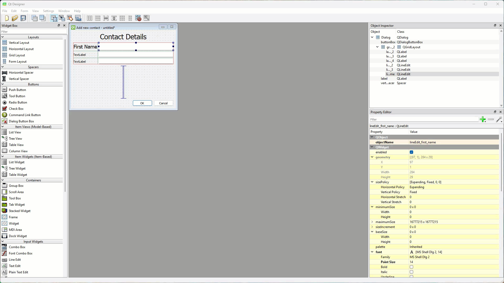

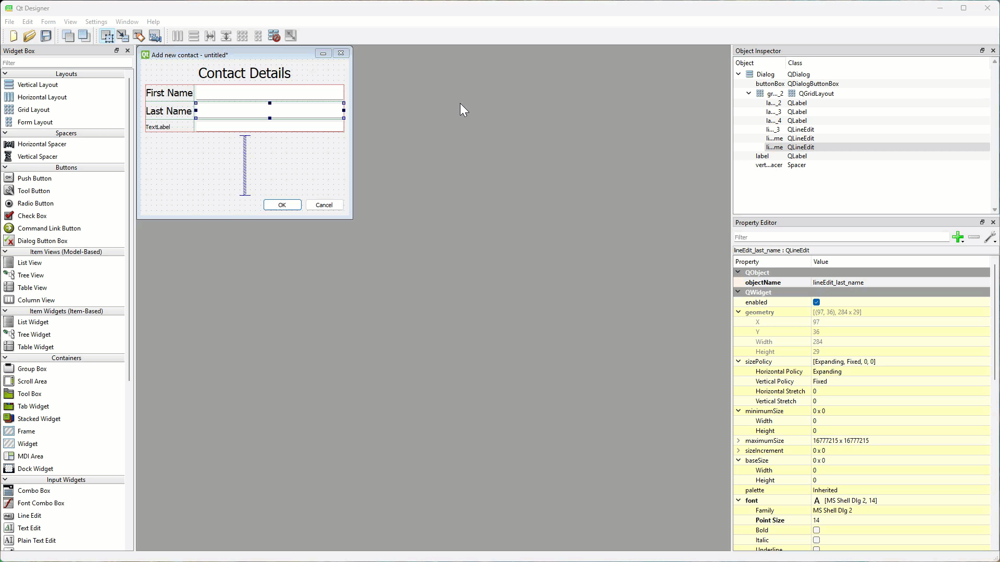

### Dialog buttons

We don't need to do anything to the **OK** and **Cancel** buttons. The **Dialog with Buttons Bottom** template has already connected them: **OK** accepts the dialog and **Cancel** rejects it. We'll use that in the next tutorial to tell which button was clicked.

### Save the dialog

1. Preview the dialog, then save it in your repo as ***new_contact.ui*** and close it.

## Testing

Check that:

1. ***contacts.ui*** has a **File** menu with **Open** and **Save**, a table and an **Add** button in the bottom-right corner
2. ***new_contact.ui*** has three labelled boxes, and its **OK** and **Cancel** buttons close the preview
3. both files are saved in the repo folder, next to our Python files

!!! tip "Digital Solutions link"
    Labelling every input box clearly, and grouping related inputs together, supports the **learnability** usability principle and the visual communication principle of **proximity**. See [Visual communication](https://damom73.github.io/digital-solutions-text-2025/visual-communication) in the Digital Solutions text.

## Exercises

### Exercise 1

Can you add an **Email** row to the new contact dialog, with a line edit named `lineEdit_email`? (You'll also need to change the code in [Tutorial 17](17_app.md) to use it, which makes a good extension.)
