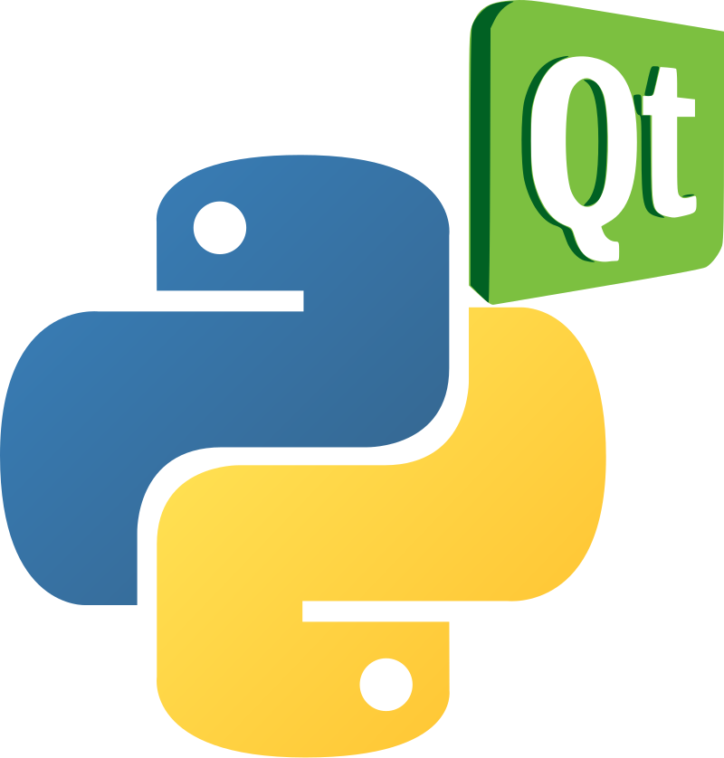

# PyQt Tutorials

{ width="200" }

Build desktop apps with a graphical user interface (GUI) in Python, using PyQt6 and Qt Designer.

## How to use this site

- Start with the **Getting Started** pages. They explain what PyQt is and set up Python, VS Code, GitHub Desktop and Qt Designer.
- **Qt Designer Basics** has five short tutorials. They teach the workflow we use for every app: design the UI in Qt Designer, then write the Python code that makes it work.
- The **Calculator**, **Time Machine**, **To Do List** and **Contacts** sections each build one app across several tutorials. Each app introduces new widgets and techniques, so work through them in order.
- Most coding tutorials finish with **Exercises**. Solutions are on the [Exercise Solutions](reference/solutions.md) page.
- **Reference** has the boilerplate code, common errors, the solutions and a glossary.

These tutorials are written for Digital Solutions, so they link to the [Digital Solutions 2025](https://damom73.github.io/digital-solutions-text-2025/) text when they use ideas from the syllabus, such as MVC, usability principles and testing.

## Callouts

Coloured boxes called **callouts** highlight different kinds of information. Each type of callout has its own colour and icon, so we can tell at a glance what it's for.

!!! learn "Learning intentions"
    This callout is at the top of every tutorial page. It lists what we will learn on that page.

!!! terms "Terminology"
    This callout comes straight after the learning intentions. It lists the new technical terms on the page, with a short definition of each. Every term is also on the [Glossary](reference/glossary.md) page.

!!! primm "PRIMM"
    This callout comes after we change our code. It asks us to **predict** what the code will do, **run** it, and **investigate** how it works. In the exercises it asks us to **modify** the code.

!!! note "Code explanation"
    This callout comes after each piece of code and explains the new or changed lines. On the tutorial pages it starts closed, so we can make our own prediction first. Click its title to open it.

!!! tip "Tip"
    This callout gives extra information, such as definitions, background facts, comparisons and hints.

!!! warning "Warning"
    This callout warns us about mistakes that are easy to make, or things that will stop our app working.

## Code blocks

Each app is built up across several tutorials, so most code blocks show a whole file. The file name is shown above the code:

```python linenums="1" hl_lines="7-8" title="first_program.py"
    def signals(self):
        """
        Connect UI signals to the corresponding slots.
        """
        self.ui.pushButton.clicked.connect(self.button_clicked)

    # ---- SLOTS ---- #
    def button_clicked(self):
        self.ui.label_2.setText("I'm clicked")
```

- the **file name** above the code tells us which file to open or create
- **line numbers** match the line numbers in VS Code and in the Code explanation
- **highlighted lines** are new or changed since the last time we saw the file, so they're the lines we need to add or change
- the **copy** button in the top-right corner copies the code to paste into VS Code

Some code blocks only show part of a file. Their line numbers start where that part sits in the file. When a tutorial asks us to repeat a change for several buttons, a **Check your code** box shows the whole file afterwards, so we can compare it with ours.

Code blocks without colours show commands to type in the VS Code terminal, or what appears in the terminal when we run our app.

## Error messages

Error messages are shown in red code blocks like this one:

``` { .text .error linenums="1" }
Traceback (most recent call last):
  File "C:\Users\student\Documents\GitHub\PyQt6-Boiler-Plate\calculator.py", line 126, in multiply_clicked
    if self.equation[-1].isdigit() or self.equation[-1] == ".":
       ~~~~~~~~~~~~~^^^^
IndexError: string index out of range
```

Under each error message, the tutorial breaks it down line by line, so we learn how to read the error and fix our code. The [Common Errors](reference/common_errors.md) page collects the errors we're most likely to see.

## Tutorial files

We create every file ourselves as we work through the tutorials, starting from the [PyQt6 boilerplate code](start/setup.md#pyqt-boilerplate-code). A few tutorials need a file that we download:

- [mr-coder.png](downloads/mr-coder.png) for [Tutorial 2](basics/02_labels.md)
- [alarm_sound.wav](downloads/alarm_sound.wav) for [Tutorial 12](time_machine/12_timer.md)
- [contacts.csv](downloads/contacts.csv) for [Tutorial 17](contacts/17_app.md)
