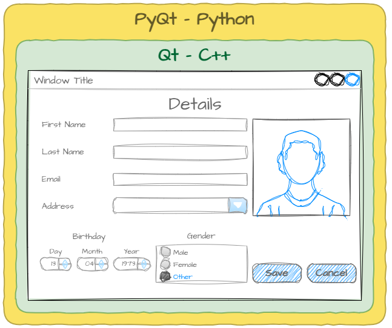
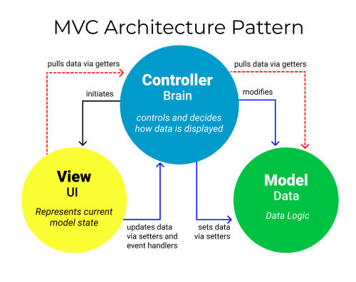

# Introduction

!!! learn "On this page we will learn"
    - what Qt and PyQt are, and how a wrapper lets Python use Qt
    - how the tutorials on this site are organised
    - how the MVC architecture pattern organises our apps
    - where to find the official Qt and PyQt documentation

!!! terms "Terminology"
    - **Qt** – a C++ framework for building apps with graphical user interfaces that run on many kinds of devices.
    - **GUI** – short for graphical user interface, a user interface made of windows, buttons, menus and other graphics that we use with a mouse, keyboard or touch.
    - **wrapper** – code that lets a program written in one language use a library written in another language.
    - **binding** – a connection inside a wrapper that makes a function or object from one language available in another.
    - **PyQt** – a Python wrapper for Qt, so we can build Qt apps in Python instead of C++.
    - **MVC** – short for Model-View-Controller, an architecture pattern that splits an app into the data (model), the user interface (view) and the logic that connects them (controller).
    - **decomposition** – breaking a big problem into smaller parts that are easier to understand and solve.
    - **modularisation** – organising a program into separate parts, called modules, that each do one job.
    - **separation of concerns** – keeping different jobs in different parts of the code, so we can change one part without breaking the others.

## What is PyQt?

**Qt** (pronounced "cute") is a framework for building **GUI** (graphical user interface) programs: apps where we click buttons, type into boxes and drag items around. It's a bit like a big box of LEGO, where each block is a ready-made part of an app. Qt runs on computers and phones, and on special-purpose devices like ATMs and car dashboards.

Qt is written in C++, which gives it fast, low-level access to the computer's hardware. Because it's so useful, people want to use Qt from other languages too, so there are **wrappers** for many popular languages.

!!! tip "Code wrappers"
    A wrapper is like a translator that lets code written in one programming language talk to code written in another. It works by creating **bindings**: connections that make functions and objects from one language available in the other.

    For example, a Python program can use a library written in C through a wrapper. The wrapper translates between Python and C, so we get the speed of C with the simplicity of Python.

**PyQt** (pronounced "pie-cute") is the Python wrapper for Qt. It lets us build the same kinds of apps we could build in C++, but in Python. We'll use **PyQt6**, the version for Qt 6.

## How the tutorials work

Right now we know how to write Python programs that run in the terminal. In these tutorials we'll learn to build apps with windows, buttons, menus and dialog boxes.

Each app is built in two parts:

1. We **design the user interface** in **Qt Designer** by dragging and dropping widgets into a window.
2. We **write the Python code** in VS Code that makes the interface do something.

The first five tutorials learn this workflow with very small apps. Then we use it to build four bigger apps (a calculator, a clock/stopwatch/timer, a to-do list and a contacts list), each one adding new Qt features.

## MVC architecture pattern

The apps we build will follow the **MVC** (Model-View-Controller) architecture pattern. MVC turns a complicated app into a set of smaller, more manageable parts. It's an example of **decomposition** and **modularisation**.

- **Model**: the data and the rules for managing it, such as the list of contacts.
- **View**: the user interface. It shows information to the user and collects their input.
- **Controller**: the logic that connects the two. It takes the user's input from the view, updates the model, and gives the view the data to show. Everything that moves between the model and the view goes through the controller.

### Why use MVC?

MVC gives us **separation of concerns**: the interface, the logic and the data live in different parts of our code. So we can change one part without breaking the others. For example, we could redesign the whole interface without touching the code that saves the data. It also makes it easier for a team to work on different parts of the same app at once.

### How we use MVC in these tutorials

- The **view** is the UI file we design in Qt Designer (a ***.ui*** file).
- The **controller** is our Python file. It loads the view and responds to what the user does.
- The **model** starts out as variables in our Python file, and later becomes files we save and load (JSON in the To Do List and CSV in Contacts).

!!! tip "Digital Solutions link"
    MVC, separation of concerns and event-driven programming are part of the Digital Solutions syllabus. The [Programming paradigms](https://damom73.github.io/digital-solutions-text-2025/paradigms) page of the Digital Solutions text explains them in more detail.

## PyQt documentation

Qt is huge, and these tutorials only cover the parts we need for our apps. When we want to do something new, these are the places to look:

- [Qt 6 documentation](https://doc.qt.io/qt-6/): PyQt's classes, methods and properties almost exactly match Qt's, so the official Qt documentation is the best place to explore what a widget can do. Use the search box, and look at the **C++ classes** results (not QML types).
- [PyQt6 documentation](https://www.riverbankcomputing.com/static/Docs/PyQt6/): the official PyQt6 documentation from Riverbank Computing. It's written for professional developers, but it explains how PyQt differs from Qt.
- [Python GUIs PyQt6 tutorials](https://www.pythonguis.com/pyqt6-tutorial/): a large set of free PyQt6 tutorials and examples.

Documentation is the official guide written by the people who made the code library, and we can use it to look up every class and method, including ones that aren't covered on this site.
