# Setup

!!! learn "On this page we will learn"
    - how to install Python, Git, GitHub Desktop, VS Code and Qt Designer
    - how to clone the PyQt6 boilerplate code from GitHub
    - how to create a virtual environment with PyQt6 installed
    - how to commit and push our code to GitHub

!!! terms "Terminology"
    - **version control** – a system that tracks changes to our files over time, so we can save versions of our work and go back to an earlier one if something breaks.
    - **Git** – the industry-standard version control system, which is free and open source.
    - **repository** – a special folder, often called a repo, that stores our project files and the history of every change made to them.
    - **GitHub** – a website that stores Git repositories online, syncs them with our computer and adds features for sharing and collaboration.
    - **GitHub Desktop** – an app that lets us use Git and GitHub without typing commands.
    - **IDE** – an Integrated Development Environment, which is an app for writing, running and fixing code.
    - **VS Code** – short for Visual Studio Code, a professional IDE that works with many programming languages through extensions.
    - **Qt Designer** – a drag-and-drop app for designing Qt user interfaces, which saves each design as a ***.ui*** file.
    - **boilerplate code** – a standard block of starting code that we reuse, with little or no change, at the start of every project.
    - **clone** – to copy a repository from GitHub onto our computer.
    - **virtual environment** – a separate space for one Python project with its own Python setup and libraries, so changes in one project don't affect another.
    - **commit** – a saved snapshot of our changes, with a message saying what we did.
    - **push** – to send our commits from our computer to the online copy of the repository.
    - **fork** – our own copy of someone else's repository on GitHub, which we are allowed to push to.

In this course we will build good programming habits. That means using a professional development environment with **version control**. So before we write any code, we need to install a few programs and set them up to work together.

!!! tip "Why this workflow?"
    There are many reasons for using this workflow, and most are outside the scope of this course. Put simply, it avoids the traps beginners often fall into, so we spend more time coding and less time fixing problems.

## Python

The first step is to install Python. If we've only used beginner editors like Thonny or Mu, Python came packaged with them. With a professional IDE we install Python ourselves.

!!! tip "Python versions"
    A new version of Python 3 comes out every year. The exact version doesn't matter for these tutorials, so install the latest one.

### Windows

1. Open the **Microsoft Store**, search for **Python** and install the latest version.
    - Why: the Store version keeps itself up to date and adds Python to the system path, so we can use it anywhere.
    - Result: Python appears in the Start menu.

### macOS

1. Go to [python.org](https://www.python.org/downloads/) and click the yellow **Download Python 3.x.x** button.
    - Why: the site detects our system and gives us the right installer.
    - Result: an installer file downloads.
2. Open the installer and follow the steps.
    - Result: Python appears in the **Applications** folder.

---

## Version control

**Version control** tracks the changes to our files over time. It lets us save versions of our work and go back to an earlier version if something breaks. It's a bit like OneDrive, but it isn't automatic: after saving our work, we choose when to sync it to the cloud.

### Git

**Git** is the industry-standard version control system. Git stores our code in a special folder called a **repository** (or **repo**) that keeps track of every change we make. We won't use Git directly, because it's built into GitHub Desktop and VS Code, but we still need to install it.

1. Go to [git-scm.com/downloads](https://git-scm.com/downloads) and download the installer for your operating system.
    - Why: GitHub Desktop and VS Code use Git behind the scenes.
    - Result: an installer file downloads.
2. Run the installer and accept all the default settings.
    - Result: Git is installed. Nothing new appears on screen, because we won't use Git by itself.

### GitHub

**GitHub** is the website that stores our repos online and syncs them with our computer. The free account is all we need.

1. Go to [github.com](https://github.com/) and click **Sign up**.
2. Use your school email to create your account (you can change it later).
    - Result: you can sign in to GitHub.

!!! tip "Git vs GitHub"
    Git is the tool that tracks changes and manages repos on our computer. GitHub is a website that stores those repos online and adds features for sharing and collaboration. GitHub is the most popular option, but there are others, such as GitLab and Bitbucket.

### GitHub Desktop

**GitHub Desktop** is an app that lets us use Git and GitHub without typing commands.

1. Go to [desktop.github.com](https://desktop.github.com/), download GitHub Desktop and run the installer, accepting the default options.
    - macOS: move the app to **Applications** and restart it when asked.
2. Open GitHub Desktop and sign in with your GitHub account.
    - Result: GitHub Desktop shows your account name and an empty list of repositories.

---

## VS Code

An **IDE** (Integrated Development Environment) is an app for writing, running and fixing code in one place. It suggests code as we type, shows errors, organises our files and runs our programs. We will use **VS Code** (Visual Studio Code).

1. Go to [code.visualstudio.com](https://code.visualstudio.com/), click **Download** and run the installer, accepting the default options.
    - Result: VS Code opens with a Welcome tab.
2. Install the [Python extension](https://marketplace.visualstudio.com/items?itemName=ms-python.python): click **Install**, then allow the page to open VS Code.
    - Why: VS Code works with many languages, and the extension adds Python support (running code, error checking and virtual environments).
    - Result: the Python extension shows as installed in VS Code's **Extensions** panel.

---

## Qt Designer

**Qt Designer** is an app for designing Qt user interfaces. We drag widgets such as labels, buttons and text boxes into a window, set their properties, and save the design as a ***.ui*** file.

1. Go to the [Qt Designer download page](https://build-system.fman.io/qt-designer-download) and download the installer for your operating system.
    - Why: this is a small, standalone copy of Qt Designer, so we don't need to install all of Qt.
    - Result: an installer file downloads.
2. Run the installer and accept the default options.
    - Result: **Qt Designer** appears in the Start menu (Windows) or the **Applications** folder (macOS).

---

## PyQt boilerplate code

!!! tip "What is boilerplate code?"
    **Boilerplate code** is a standard block of starting code that we reuse at the start of every project. It sets up the basic structure, so we only need to add the parts that make each app different.

We'll start from some PyQt boilerplate code in a GitHub repository. We need to **clone** (copy) it onto our computer.

1. Go to the [PyQt6 Boiler Plate repo](https://github.com/DamoM73/PyQt6-Boiler-Plate), click the green **Code** button, then click the **copy** button beside the HTTPS URL.
    - Result: the repo's URL is on the clipboard.

    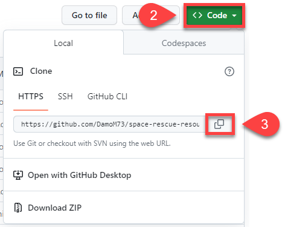

2. In GitHub Desktop, open the **File** menu and click **Clone repository**.

    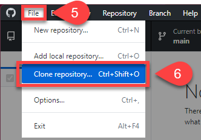

3. Choose the **URL** tab, paste the URL into the **URL or username/repository** box, and click **Clone**.
    - Result: GitHub Desktop shows **PyQt6-Boiler-Plate** as the **Current repository**.

    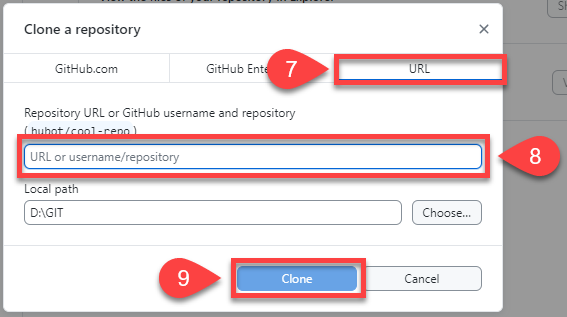

!!! tip "Git and GitHub terms"
    - **Repository (repo)**: a special folder that stores our project files and their history
    - **Commit**: a saved snapshot of our changes, with a message saying what we did
    - **Push**: sending our commits to the online copy of the repo
    - **Pull**: getting the latest changes from the online copy
    - **Remote**: the online copy of the repo (on GitHub)
    - **Origin**: the main remote copy of our repo
    - **Clone**: copying a repo from GitHub to our computer
    - **Local**: the copy of the repo on our computer
    - **Fork**: our own copy of someone else's repo

    The "other people" we share our repo with might just be us, on another computer.

---

## Open the repo in VS Code

We use GitHub Desktop to manage our workflow: opening our code in VS Code, **committing** (saving) our work to the local repo, and **pushing** (syncing) it to GitHub.

1. In GitHub Desktop, check the **Current repository** is **PyQt6-Boiler-Plate**, then click **Open in Visual Studio Code**.
    - Why: this opens the whole repo folder in VS Code, which the virtual environment needs.
    - Result: VS Code opens, and the file panel shows the repo's files, including ***main_window.py***, ***ui_main_window.py*** and ***requirements.txt***.

    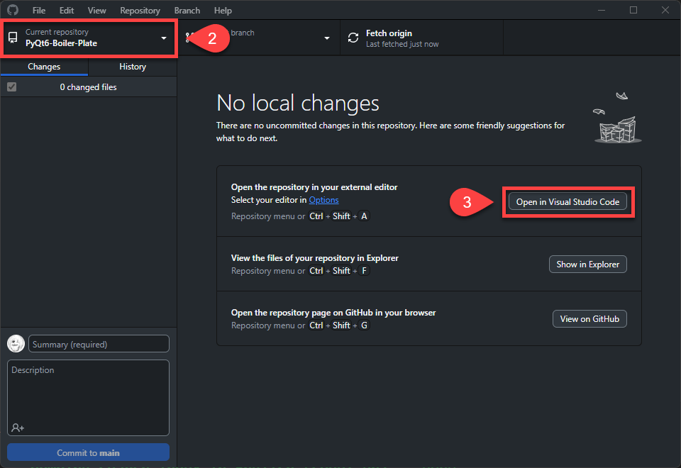

---

## Virtual environment

A **virtual environment** keeps each Python project separate. Each project gets its own space with its own Python setup and libraries, so changes in one project don't affect another. It's like giving each project its own room with its own tools.

!!! tip "requirements.txt"
    The ***requirements.txt*** file lists the extra libraries our project needs. For these tutorials that's just `pyqt6`. VS Code reads this file when it creates the virtual environment. If we ever need to install the libraries again, we run this command in a VS Code terminal that shows `(.venv)`:

    ```text
    python -m pip install -r requirements.txt
    ```

1. In VS Code, press ++ctrl+shift+p++ (++cmd+shift+p++ on macOS), type **Python** and choose **Python: Create Environment...**

    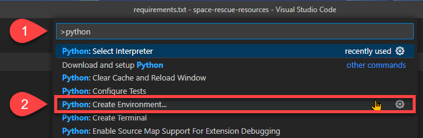

2. Choose **Venv**.

    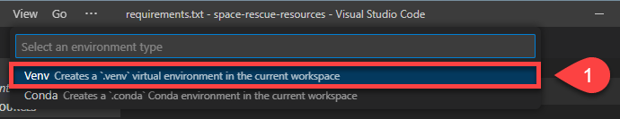

3. Choose the latest version of Python we installed.

    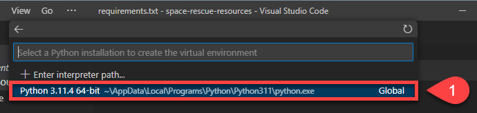

4. Tick **requirements.txt**, then click **OK**.
    - Why: this installs PyQt6 into the new environment.
    - Result: VS Code creates a ***.venv*** folder, installs PyQt6 and selects the environment.

    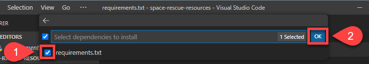

5. Open the **Terminal** menu and choose **New Terminal**.
    - Why: VS Code activates the virtual environment in every new terminal, and we'll use the terminal to convert our UI files.
    - Result: the terminal prompt starts with `(.venv)`.

    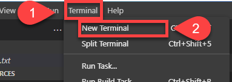

6. Open ***main_window.py*** and check the right of the VS Code status bar.
    - Result: it shows the Python version and `('.venv': venv)`, so the environment is active.

    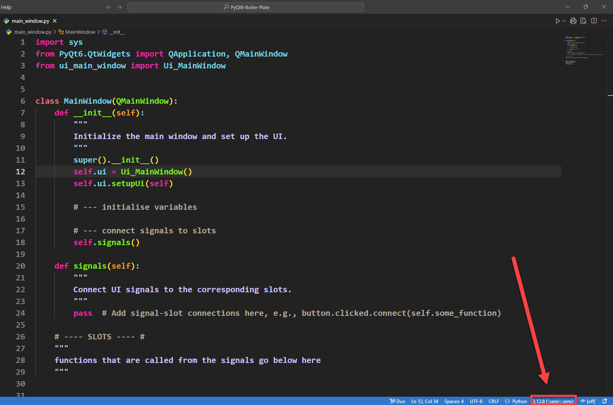

!!! warning "No (.venv) in the terminal?"
    - If the prompt doesn't start with `(.venv)`, close the terminal (bin icon) and open a new one.
    - If running a file gives `ModuleNotFoundError: No module named 'PyQt6'`, VS Code is using the wrong Python. Press ++ctrl+shift+p++ (++cmd+shift+p++ on macOS), choose **Python: Select Interpreter** and pick the one with `.venv` in its name.
    - Never commit the ***.venv*** folder, because ***requirements.txt*** can recreate it. VS Code puts a small ***.gitignore*** file inside ***.venv***, so GitHub Desktop normally leaves it out. If GitHub Desktop lists hundreds of ***.venv*** files, right-click one of them and choose **Ignore folder (add to .gitignore)**.

---

## First commit and push

Let's make a small change, then commit and push it, so our own copy of the repo is on GitHub.

1. Open ***README.md***, replace its contents with the text below and save it.

    ```text
    # PyQt Tutorials

    Learning how to use PyQt to make GUIs
    ```

2. In GitHub Desktop, type **Made first change** in the **Summary (required)** box and click **Commit to main**.
    - Result: the change disappears from the **Changes** list.

    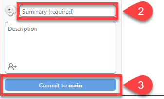

3. Click **Push origin**.
    - Result: an error appears, because the repo belongs to someone else and we can't push to it.

    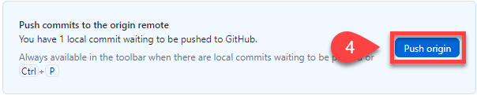

4. Choose **Fork this repository**, then **For my own purposes**, and click **Continue**.
    - Why: a **fork** is our own copy of the repo on GitHub, so we can push to it.
5. Click **Push origin** again.
    - Result: our commit is now on GitHub, in our own copy of the repo.

We're ready to make our first app.
