# Tutorial 8 - Time Machine UI

!!! learn "In this tutorial we will learn"
    - what container widgets are, and how a tab widget makes a multi-page UI
    - how to add, name and label tabs in Qt Designer
    - how to lay out a clock, a stopwatch and a timer, each on its own tab
    - how to use spin boxes for number input

!!! terms "Terminology"
    - **container widget** – a widget that holds and organises other widgets, such as a group box or a tab widget.
    - **tab widget** – a container widget with several pages, where the user clicks a tab to choose which page to see.
    - **spin box** – an input widget for whole numbers, with up and down arrows to change the value.
    - **mock-up** – a drawing of a planned user interface that shows its layout and parts before it is built.

To learn more Qt features, we'll build a new app: the **Time Machine**, a clock, stopwatch and timer in one window. Each one gets its own tab. In this tutorial we'll build the UI, and over the next four tutorials we'll make each tab work.

Now that we know our way around Qt Designer, the steps are grouped: each step gives the widget and the properties to set, and the GIFs show the details.

## Plan the UI

| Tab | Widgets | Purpose |
| --- | --- | --- |
| **Clock** | one large label | shows the current time |
| **Stopwatch** | one large label, four buttons (Start, Pause, Stop, Reset) | counts up from zero |
| **Timer** | three spin boxes with labels (hours, minutes, seconds), one large label, four buttons | counts down from the time we set |

!!! tip "Digital Solutions link"
    Planning a UI before building it is what a **mock-up** is for. The [Mock-ups](https://damom73.github.io/digital-solutions-text-2025/mock-ups) page of the Digital Solutions text shows how to draw and annotate them.

## Format the main window

1. Create a new **Main Window**, remove the **menu bar** and the **status bar**, set **geometry** to `800` × `600` and **windowTitle** to **Time Machine**.

    

## Add the tab widget

A **tab widget** is a **container widget**: a widget that holds and organises other widgets. Each tab is a separate page of the UI.

!!! tip "Container widgets"
    Qt's common container widgets are:

    1. [QWidget](https://doc.qt.io/qt-6/qwidget.html): the basic container for any widgets
    2. [QGroupBox](https://doc.qt.io/qt-6/qgroupbox.html): a box with a title, for grouping related widgets
    3. [QFrame](https://doc.qt.io/qt-6/qframe.html): a simple container with a border
    4. [QTabWidget](https://doc.qt.io/qt-6/qtabwidget.html): a tabbed interface
    5. [QStackedWidget](https://doc.qt.io/qt-6/qstackedwidget.html): switches between pages, one at a time
    6. [QScrollArea](https://doc.qt.io/qt-6/qscrollarea.html): adds scroll bars when the content is too big
    7. [QSplitter](https://doc.qt.io/qt-6/qsplitter.html): sections the user can resize by dragging

1. Drag a **Tab Widget** from the **Containers** section of the Widget Box onto the window canvas, then right-click the canvas and choose **Lay out** → **Lay Out Vertically**.
    - Result: the tab widget fills the window, with two tabs.

    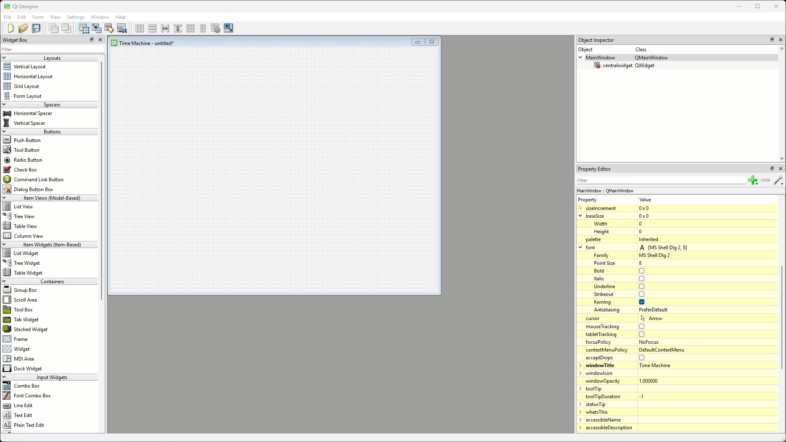

## Organise the tabs

We need three tabs, so we'll add one.

1. In the **Object Inspector**, right-click **tabWidget** and choose **Insert Page** → **After Current Page**.

    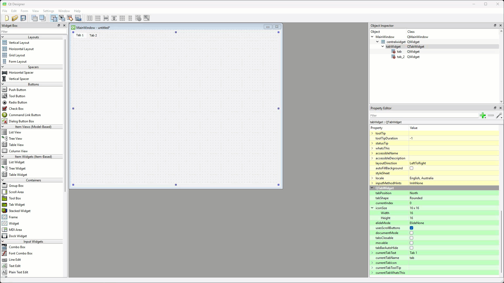

2. Click each tab in turn and set its properties in the **QTabWidget** section of the Property Editor:

    | Tab | currentTabText | currentTabName |
    | --- | --- | --- |
    | left | **Clock** | `tab_clock` |
    | centre | **Stopwatch** | `tab_stopwatch` |
    | right | **Timer** | `tab_timer` |

    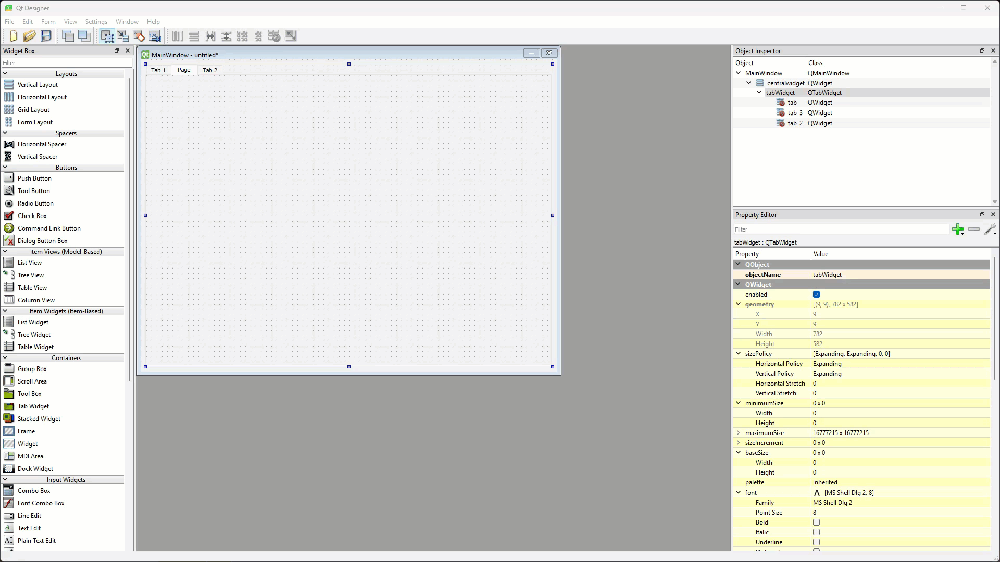

3. Select the tab widget and set its **font** → **Point Size** to `20`, so the tabs are easy to read.

    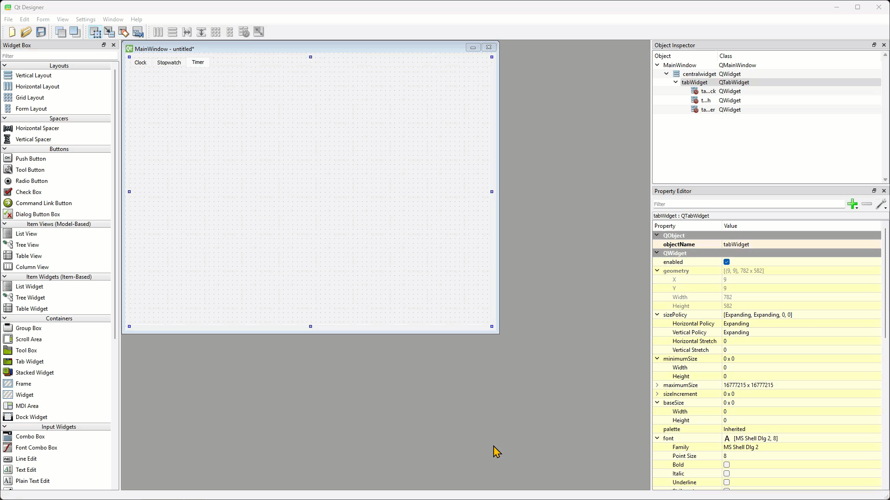

## Clock tab

1. Click the **Clock** tab, drag a **Label** onto it, then right-click the tab and choose **Lay out** → **Lay Out Vertically**. Set the label's **objectName** to `label_clock`.

    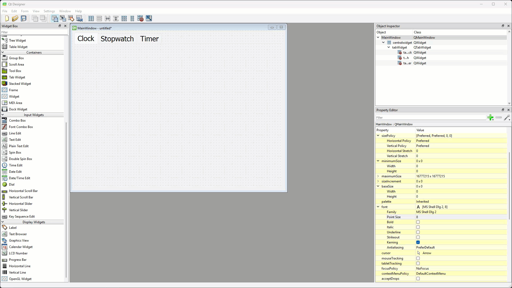

2. Set `label_clock`'s **font** → **Point Size** to `100` and **alignment** → **Horizontal** to **AlignHCenter**.

    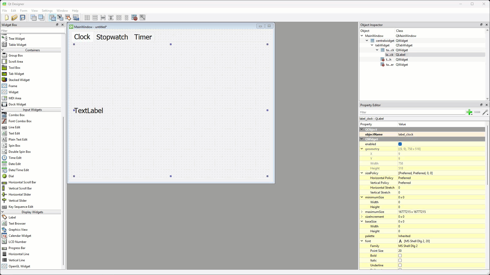

## Stopwatch tab

1. Click the **Stopwatch** tab. Drag a **Label** to the top half and a **Horizontal Layout** to the bottom half, then right-click the tab and choose **Lay out** → **Lay Out Vertically**.

    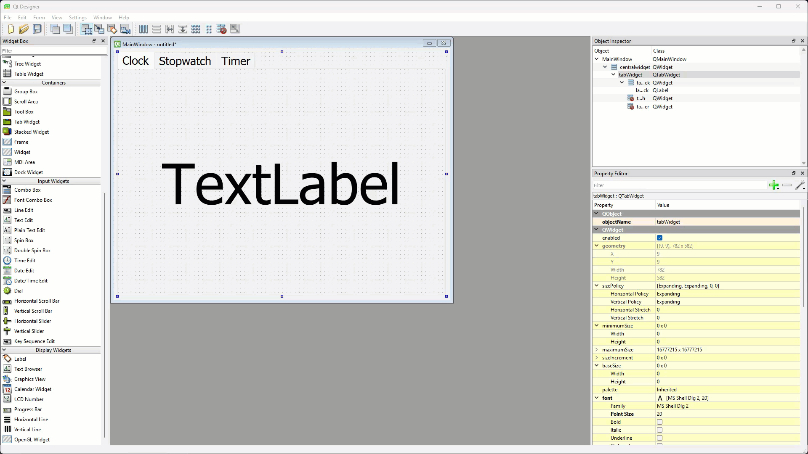

2. Drag four **Push Buttons** into the horizontal layout, and a **Vertical Spacer** above and below the label.

    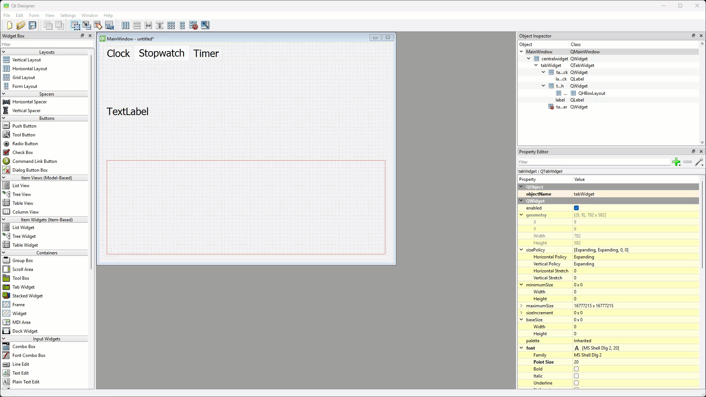

3. Name the widgets and set the buttons' text:

    | Widget | objectName | text |
    | --- | --- | --- |
    | label | `label_stopwatch` | |
    | first button | `pushButton_sw_start` | **Start** |
    | second button | `pushButton_sw_pause` | **Pause** |
    | third button | `pushButton_sw_stop` | **Stop** |
    | fourth button | `pushButton_sw_reset` | **Reset** |

    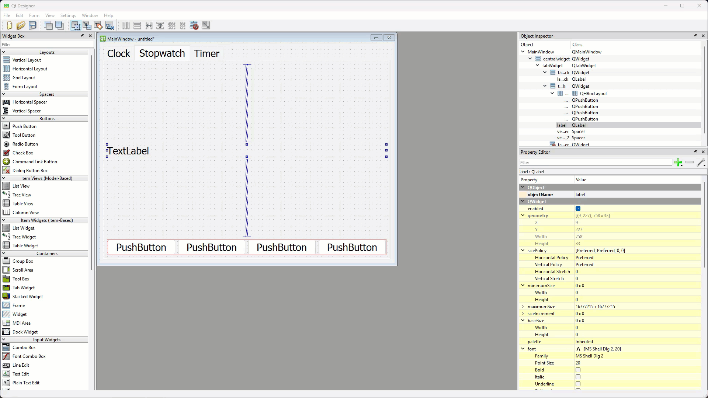

4. Set `label_stopwatch`'s **font** → **Point Size** to `100` and **alignment** → **Horizontal** to **AlignHCenter**, and set every button's **Point Size** to `30`.

    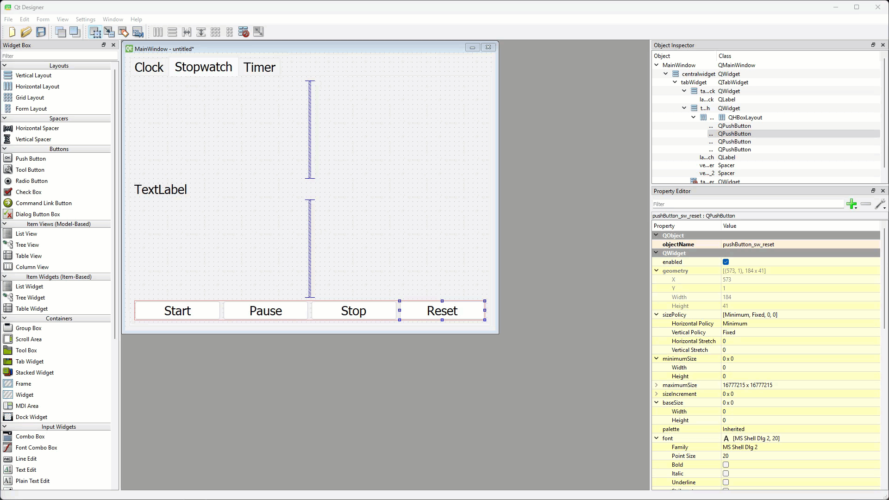

5. Set **sizePolicy** → **Vertical Policy** to **MinimumExpanding** for `label_stopwatch` and all four buttons.

    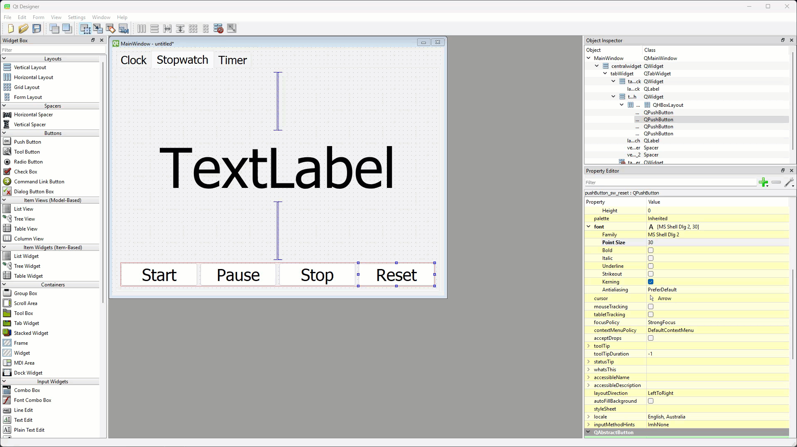

## Timer tab

1. Click the **Timer** tab. Drag a **Label** to the top half, a **Grid Layout** under it and a **Horizontal Layout** under that, then right-click the tab and choose **Lay out** → **Lay Out Vertically**.

    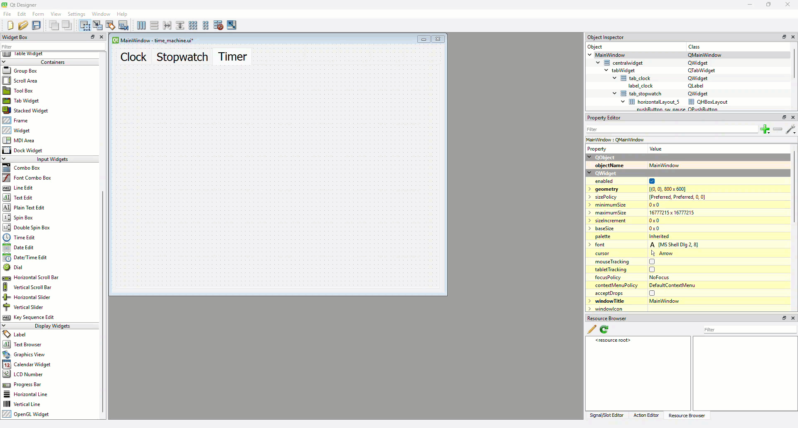

2. Drag three **Labels** side by side into the grid layout. Set their text to **Hours**, **Minutes** and **Seconds**, and their **alignment** → **Horizontal** to **AlignHCenter**.

    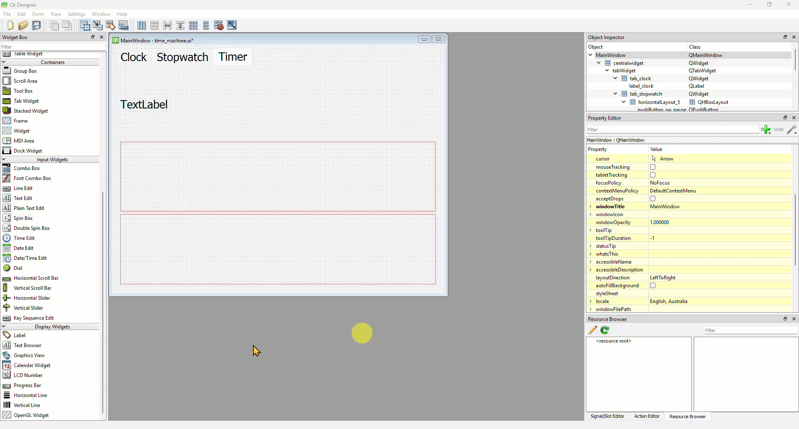

3. Drag a **Spin Box** under each label and name them `spinBox_hours`, `spinBox_minutes` and `spinBox_seconds`.

    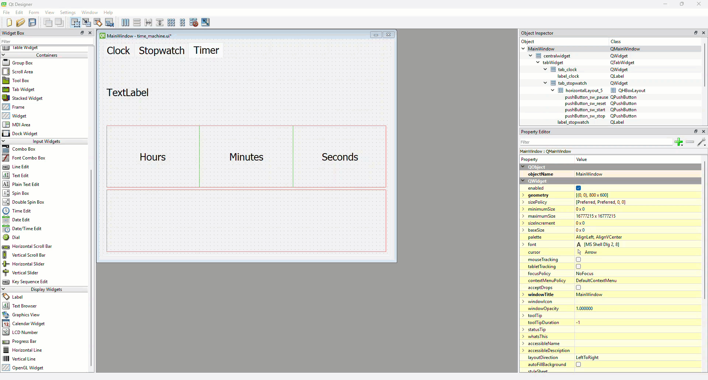

4. For each spin box, set **font** → **Point Size** to `30` and **alignment** → **Horizontal** to **AlignRight**.

    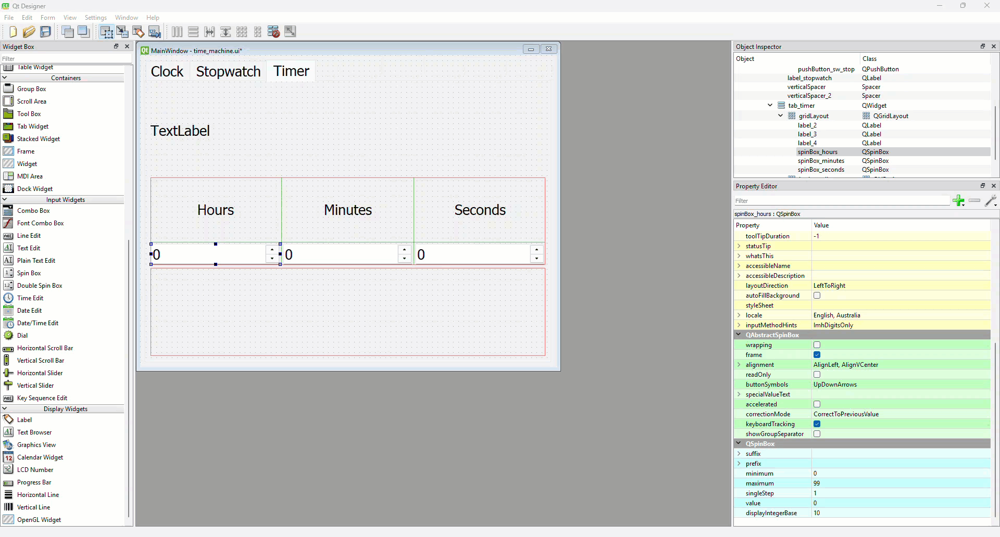

5. Drag four **Push Buttons** into the horizontal layout.

    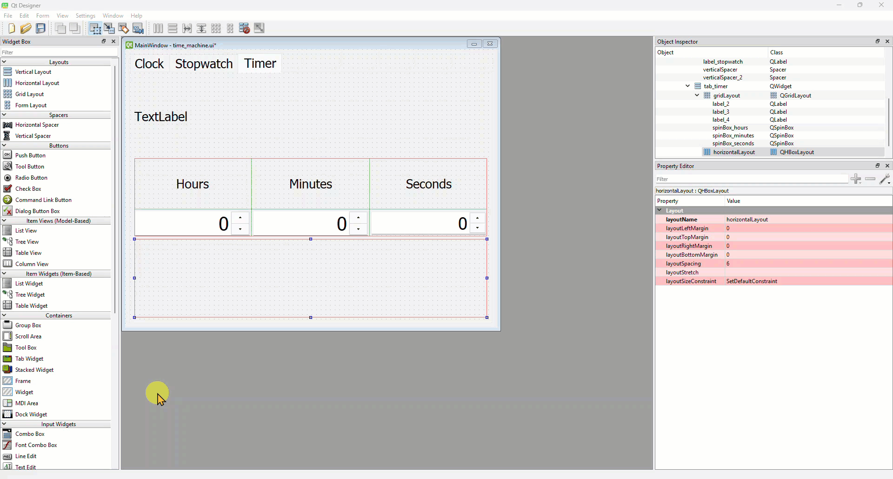

6. Set the buttons' properties (every button's **font** → **Point Size** is `30`):

    | Button | objectName | text |
    | --- | --- | --- |
    | first | `pushButton_tm_start` | **Start** |
    | second | `pushButton_tm_stop` | **Stop** |
    | third | `pushButton_tm_pause` | **Pause** |
    | fourth | `pushButton_tm_reset` | **Reset** |

    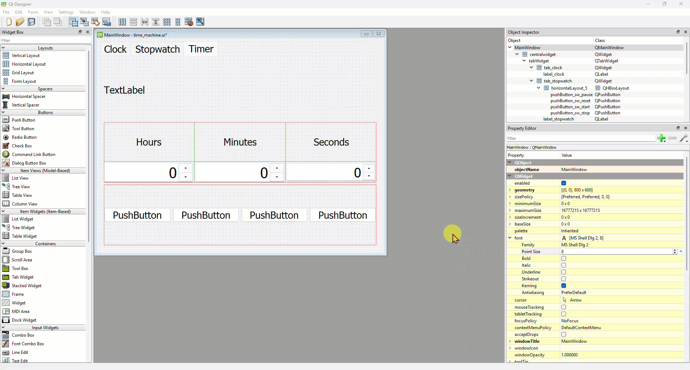

7. Name the top label `label_tm_time`, set its **font** → **Point Size** to `100` and **alignment** → **Horizontal** to **AlignHCenter**, and add a **Vertical Spacer** above and below it.

    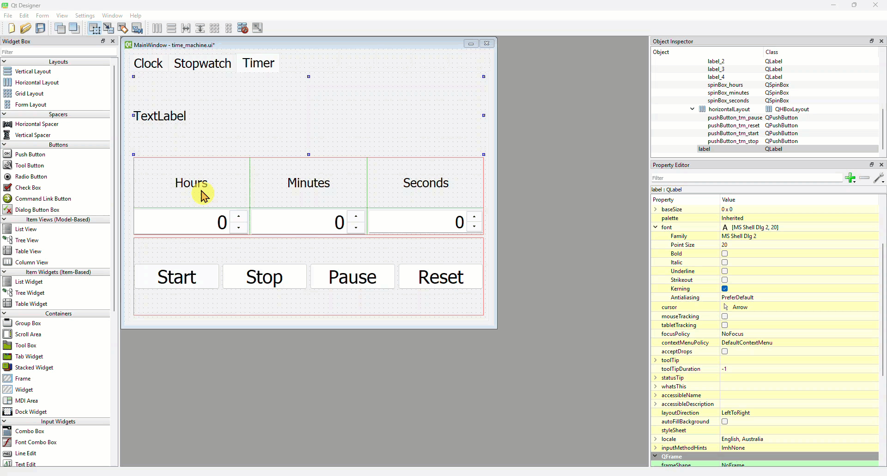

That's the UI done. Save it in your repo as ***time_machine.ui***.

## Testing

Preview the UI with ++ctrl+r++ (++cmd+r++ on macOS) and check that:

1. there are three tabs, labelled **Clock**, **Stopwatch** and **Timer**
2. each tab has the widgets in the plan, and resizes neatly with the window
3. the spin boxes' arrows change their values

The widgets won't do much yet, but they should all be there.

## Exercises

### Exercise 1

Can you design a fourth tab, **World Clock**, with three labels that will show the time in three different cities? Use a grid layout so each city's name sits beside its time. (We won't code it, but it's a good extension to come back to after [Tutorial 10](10_clock.md).)
