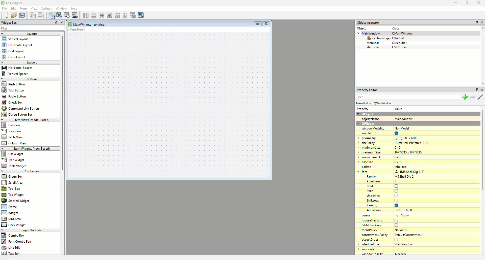
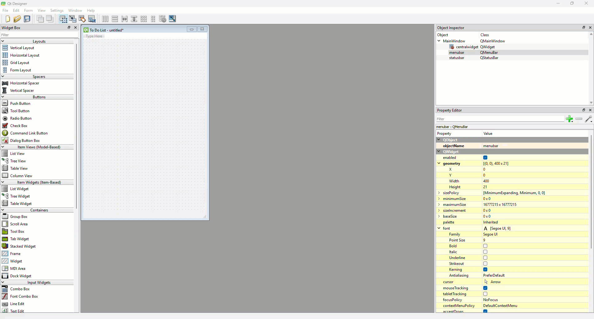
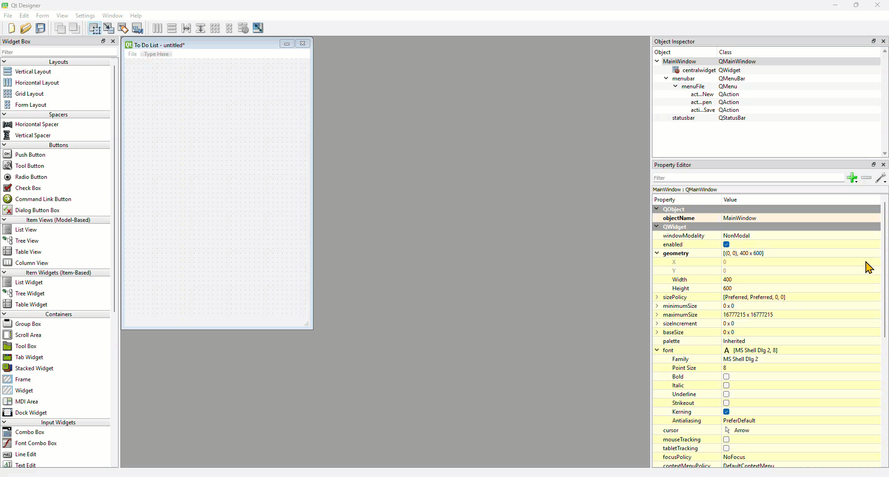
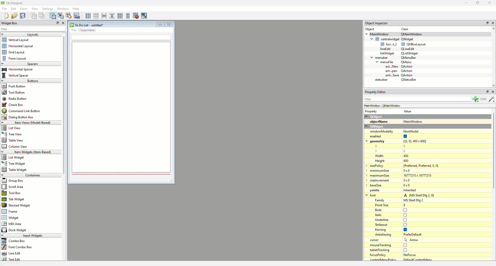
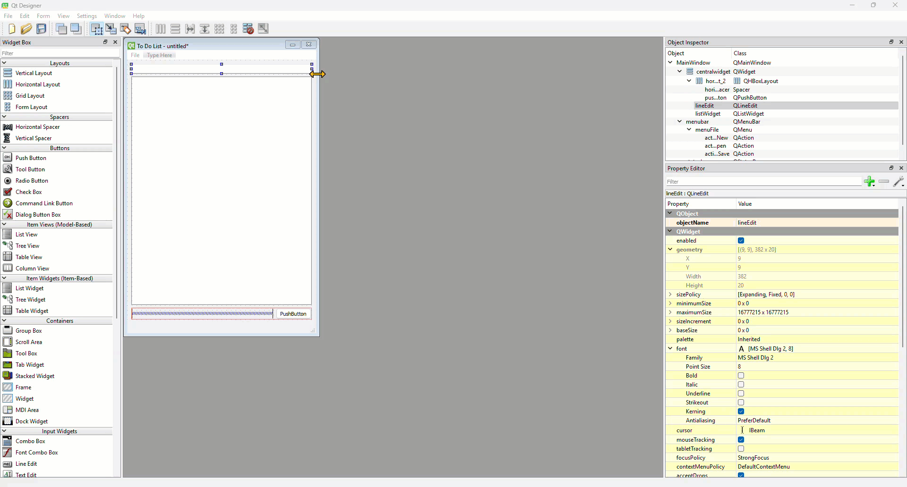
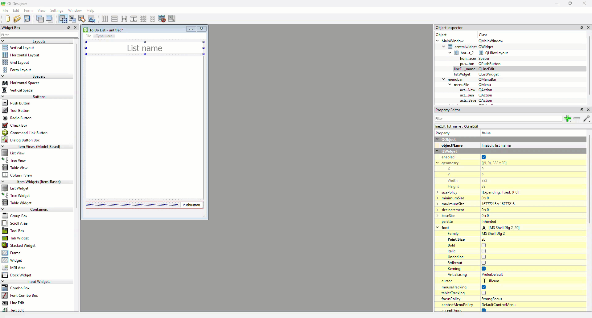
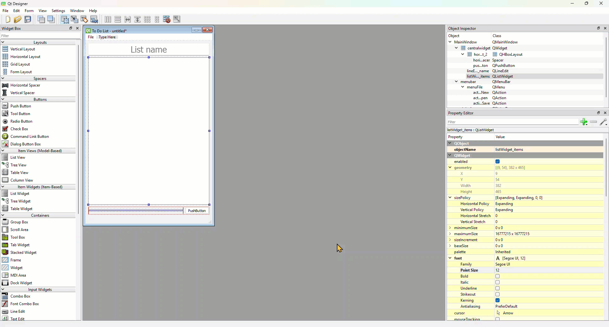

# Tutorial 13 - To Do UI

!!! learn "In this tutorial we will learn"
    - how to add a menu with menu items in Qt Designer
    - how to use a line edit for text input and a list widget to show a list
    - how to combine vertical and horizontal layouts with a spacer

!!! terms "Terminology"
    - **menu bar** – the bar across the top of a window that holds menus such as **File**.
    - **line edit** – an input widget for one line of text.
    - **list widget** – a widget that shows a list of items the user can scroll through and click.
    - **placeholder text** – faint text shown in an empty input box that hints at what to type.
    - **learnability** – the usability principle that a digital solution is easy for new users to learn, because it is familiar and clearly labelled.

Our next app is a **To Do List**. Through it we'll learn Qt's menu system, line edits, list widgets and dialog boxes. Before we write any code, we need to build the UI in Qt Designer.

## Plan the UI

| Widget | objectName | Purpose |
| --- | --- | --- |
| **File** menu with **New**, **Open** and **Save** | `actionNew`, `actionOpen`, `actionSave` | start, open and save lists |
| Line Edit | `lineEdit_list_name` | the list's name |
| List Widget | `listWidget_items` | the tasks in the list |
| Push Button | `pushButton_add` | adds a task |

## Window settings

1. Create a new **Main Window**. This time keep the **menu bar**. Set **geometry** to `400` × `600` and **windowTitle** to **To Do List**.

    

## Menu

1. Double-click **Type Here** in the menu bar, type **File** and press ++enter++.
2. In the new **File** menu, double-click **Type Here**, type **New** and press ++enter++. Do the same for **Open** and **Save**.
    - Result: Qt Designer creates an action for each menu item, named `actionNew`, `actionOpen` and `actionSave`. We'll connect them to slots in [Tutorial 15](15_advanced.md).

    

## Workspace

### Add the widgets

1. Drag a **Line Edit** onto the window canvas, a **List Widget** (not the List View) below it, and a **Horizontal Layout** below that. Then right-click the canvas and choose **Lay out** → **Lay Out Vertically**.

    

2. Use the **Object Inspector** to put a **Push Button** in the horizontal layout, then drag a **Horizontal Spacer** to the left of the button.
    - Result: the button sits on the right, under the list.

    

### Set the properties

1. Select the line edit and set:

    | Property | Value |
    | --- | --- |
    | objectName | `lineEdit_list_name` |
    | font → Point Size | `20` |
    | alignment → Horizontal | **AlignHCenter** |
    | placeholderText | **List name** |

    

2. Select the list widget and set **objectName** to `listWidget_items` and **font** → **Point Size** to `12`.

    

3. Select the push button and set:

    | Property | Value |
    | --- | --- |
    | objectName | `pushButton_add` |
    | sizePolicy → Horizontal Policy | **MinimumExpanding** |
    | font → Point Size | `12` |
    | text | **Add item** |

    

## Save and test

1. Save the UI in your repo as ***to_do_list.ui***.
2. Preview it with ++ctrl+r++ (++cmd+r++ on macOS) and check that:
    1. the **File** menu has **New**, **Open** and **Save**
    2. **List name** appears faintly in the empty line edit, and disappears when we type
    3. the list and button resize neatly with the window

!!! tip "Digital Solutions link"
    Placeholder text and clear button labels help users learn an interface without instructions, which is the **learnability** usability principle. See [Usability](https://damom73.github.io/digital-solutions-text-2025/usability-principles) in the Digital Solutions text.

## Exercises

### Exercise 1

Can you add an **Edit** menu with a **Clear completed** item, and a **Help** menu with an **About** item? Check their action names in the Property Editor. We won't code them yet, but they're useful extensions after [Tutorial 15](15_advanced.md).
